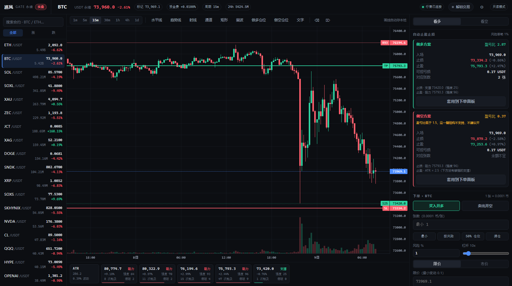

# 巡风 · Gate 永续日内台

单人在本地跑的交易终端。看 K 线、看自动识别出的支撑阻力位、按结构价下单。




## 能做什么

- 连接 Gate.io USDT 永续合约，公共行情走 WebSocket，实时更新当前 K 线。
- 从 K 线里识别支撑位和阻力位，每个位给出强度、触及次数、假突破次数。
- 按识别出的位推出做多和做空的止盈止损，算出盈亏比。
- 手动下单、市价平仓、挂价格触发单做止损止盈。
- 图上画线，画完自动存浏览器本地。
- 抓当前币种的新闻，按相关度和时间排出来，再算一个情绪分。

## 需要什么

- Node.js 22 或更高版本。
- pnpm。
- Gate.io 的 API 密钥。到 Gate 的「API 管理」创建，权限勾选 **合约交易 · 读写**。不要开提现权限。

## 启动

```bash
pnpm install
pnpm build          # 打包前端，产物在 web/dist
pnpm start          # 启动服务，http://127.0.0.1:8787
```

开发模式用 `pnpm dev`。它会同时起前端热更新（5273 端口）和后端（8787 端口），前端把 `/api` 和 `/ws` 转发给后端。

Windows 上直接双击 `start.bat` 也行。

## 第一次配置密钥

1. 打开页面，点右上角齿轮。
2. 选环境（模拟盘 / 实盘），填对应的 KEY 和 SECRET，保存。
3. 点「接口体检」。读到账户权益就是通了。

每个环境一套密钥，存在 `server/.env` 的两组变量里：`GATE_TESTNET_KEY` 和 `GATE_LIVE_KEY`。切环境不用重填密钥。

密钥只写进 `server/.env`，只有服务端读。页面拿到的永远是尾号四位。

## 模拟盘和实盘

设置页顶部的「环境」按钮选打哪个环境。当前是模拟盘。

| | 模拟盘 | 实盘 |
|---|---|---|
| 账户、持仓、下单 | `api-testnet.gateapi.io`，测试网假钱 | `api.gateio.ws`，真钱 |
| K 线、成交、ticker | 主网 | 主网 |
| 密钥 | 必须用测试网密钥 | 必须用主网密钥 |

行情永远取主网，因为测试网的行情是编造的：它的 BTC 24 小时成交量能报到 880 亿 USDT，K 线在图上是一堵乱墙。拿它做技术分析没有意义。所以两边分开取数据。

到 Gate 测试网建密钥：<https://www.gate.io/testnet> 。测试网账户的余额也是假的，可以在测试网页面自己充值。

从模拟盘切到实盘时，下单开关会自动关掉，需要再手动打开一次。

## 持仓模式

Gate 有单向持仓和双向持仓两种模式，账户在哪一种由交易所决定，页面上改不了。两种模式都支持。

| | 单向持仓 | 双向持仓 |
|---|---|---|
| 同一合约 | 只能有一个方向的仓 | 多空可以同时持有 |
| 读持仓接口 | 返回一个对象 | 返回两条：`dual_long` 和 `dual_short` |
| 平仓 | `auto_size: close_long` | 同左 |

平仓统一用 `auto_size`。老的 `close: true` 在双向模式下会被 Gate 直接拒绝（`POSITION_DUAL_MODE: close is not allowed in dual-mode`）。`auto_size` 两种模式都吃，所以只有一条代码路径。

双向模式下同一个合约可能同时有多头和空头持仓，页面按方向分成两张卡，平仓也只平指定的那一边。

## 下单要过的三道闸

三层都必须打开，缺一层服务端就拒绝下单。模拟盘里这三层照常生效，方便提前练熟流程。

| 层 | 位置 | 作用 |
|---|---|---|
| LIVE_TRADING | `server/.env` 或设置页的开关 | 关掉后服务端拒绝所有下单、撤单、改杠杆请求 |
| 解锁交易 | 页面右上角按钮 | 解锁后 10 分钟内可以下单，过了自动失效 |
| 风控上限 | `server/.env` | 单笔名义价值、最大杠杆、单笔最大张数 |

风控上限在服务端校验，页面绕不过去。默认单笔 500 USDT，杠杆不超过 20 倍。

下单要点两次：第一次显示「确认下单」条，第二次才真的发出去。

## 支撑阻力怎么算的

代码在 `server/src/levels.ts`。只用当前 K 线之前的数据，任何一根 K 线在生成自己的结论时都不用后面的数据，所以实盘和回测给出的位一致。

打分融合四路证据：

| 证据 | 权重 | 说明 |
|---|---|---|
| 摆动点聚类 | 42 | 价格在这里反复转向，是主要的结构证据 |
| 成交量分布 | 24 | 位附近累计成交量越大，越有真实筹码承接 |
| 新鲜度 | 16 | 越新的触及越有参考价值，按半衰期衰减 |
| 假突破次数 | 10 | 被捅穿又收回来，说明这个位置守得住 |
| 整数关口 | 8 | 人爱在这些价格挂单 |

两级聚类。第一级把同一位置的摆动点归堆。第二级把间距小于 `容差 × 2.2` 的堆并成一条带，避免一个阻力带在图上散成四条差 0.3% 的线。

下跌途中价格贴近区间底部时，下方的位会很少。这不是缺陷：持续下跌中每根新低的下方还在创新低，永远成不了确认的摆动点。

## 自动止盈止损怎么来的

代码在 `server/src/levels.ts` 的 `planBracket`。

- 止损放在最近的支撑下方（做多）或最近的阻力上方（做空），留 0.3 个 ATR 缓冲。
- 止盈放在最近的强阻力（做多）或强支撑（做空）。
- 止损最窄 0.8 个 ATR，最远 4%。贴在入场价上的位会把止损算成 0.1%，一个抖动就没了。
- 盈亏比低于 1.5 也照常给出，但标红写「不建议开」，不假装能用。
- 下方没有像样的支撑时止损退回 ATR，并在依据里写明。

## 新闻雷达怎么来的

代码在 `server/src/news.ts`。不依赖任何第三方服务，也不需要 API key。

抓五个公开 RSS：Cointelegraph、Decrypt、The Block、Bitcoin Magazine、CoinJournal，合并后缓存 12 分钟。先从合约名取出币种（`SOL_USDT` 取 `SOL`），再用关键词表匹配标题和摘要——标题命中权重是摘要的三倍，24 小时内的报道权重最高。

情绪分用一份看涨/看跌词表算：涨的词加分，跌的词减分，句子里有否定词就整体反向，最后截到 -1 到 1。多条新闻按相关度加权平均，超过 ±0.15 判偏多或偏空，否则算中性。

**新闻不参与止盈止损的计算。** 冷门合约本来就没有媒体报道，让这种噪音去影响止损价位风险太大。卡片里没有新闻就明说没有，不会为了填满去凑不相关的报道。

## 目录

```
server/          Node + TypeScript，Express
  src/gate/rest.ts     Gate REST 客户端，含 HMAC-SHA512 签名
  src/gate/market.ts   公共 WebSocket，按引用计数映射订阅
  src/levels.ts        支撑阻力识别与止盈止损推导
  src/news.ts          新闻抓取、币种匹配、情绪打分
  src/routes.ts        HTTP 接口，含风控校验
  scripts/             命令行体检脚本
web/             React + Vite + lightweight-charts
  src/components/ChartPane.tsx   图表、画图工具、价位线
  src/components/NewsCard.tsx    新闻雷达卡片
```

## 体检命令

```bash
pnpm -F server exec tsx scripts/check-levels.ts BTC_USDT 15m
pnpm -F server exec tsx scripts/check-levels.ts SOL_USDT 1h
```

输出识别出的位、两个方向的止盈止损方案，并跑四项自检：确定性、不用未来数据、上下都有位、同带已合并。

服务在跑时，还可以横向扫一批合约：

```bash
node server/scripts/check-balance.mjs
```

输出每个合约在 5m、15m、1h、4h 上的支撑阻力数量和两个方向的盈亏比，低于 1.5 的标 ✗。

## 已知限制

- 私有接口在测试网（单向和双向两种持仓模式各跑一遍）和实盘上都跑通了完整流程：改杠杆、限价挂单、撤单、市价开仓、挂止损止盈、撤触发单、市价平仓。实盘用的是 1 张最小张数，往返成本 0.0074 USDT。
- 双向持仓下，同一个合约的多头和空头是两个独立的仓。逆势加仓时交易所会新开一边，不会减少已有那一侧，这是双向模式的语义，不是缺陷。
- 不处理资金费率结算对冲。持仓过 8 小时会扣或收资金费，页面顶部只显示当前费率。
- 新闻源全是英文媒体。主流币覆盖充分，`JCT`、`SKHYNIX` 这类只有几十个合约的小币基本没有报道。
- 情绪分是词表算的，看不懂反讽和上下文，只能当参考，不能当信号。
