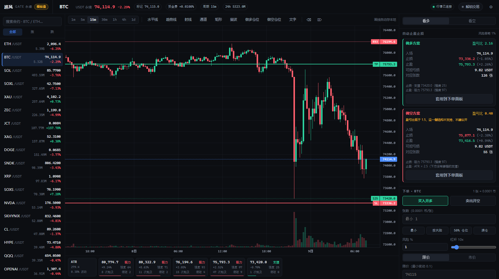

# 巡风 · Gate 永续日内台

单人在本地跑的交易终端。看 K 线、看自动识别出的支撑阻力位、按结构价下单。




## 能做什么

- 连接 Gate.io USDT 永续合约，公共行情走 WebSocket，实时更新当前 K 线。
- 从 K 线里识别支撑位和阻力位，每个位给出强度、触及次数、假突破次数。
- 按识别出的位推出做多和做空的止盈止损，算出盈亏比。
- 手动下单、市价平仓、挂价格触发单做止损止盈。
- 持仓上套用自动方案覆盖旧的保护单，也可以自己填，或者干脆不设。
- 挂着的委托能改价改量，加仓和反手都在持仓卡里点。
- 图上画线，画完自动存浏览器本地。
- 抓当前币种的新闻，按相关度和时间排出来，再算一个情绪分。
- 认出锤子线、吞没、射击之星这类 K 线形态，直接标在图上。

- 图上标出真实持仓的成本均价、挂着的止损止盈，以及左上角那块的已盈亏：多少张、开仓价、标记价、赚亏多少、
  打到止损止盈各平出多少钱。
- 往回拖到最左边会自动补更早的 K 线，一次 500 根，视口不跳。
- 把技术面和新闻面一起交给大模型，给一个偏多、偏空或观望的判断，并指出矛盾在哪。

## 需要什么

- Node.js 22 或更高版本。
- pnpm。
- Gate.io 的 API 密钥。到 Gate 的「API 管理」创建，权限勾选 **合约交易 · 读写**。不要开提现权限。

## 启动

```bash
pnpm install
pnpm build          # 打包前端，产物在 web/dist
pnpm start          # 启动服务，http://127.0.0.1:8787
```

开发模式用 `pnpm dev`。它会同时起前端热更新（5273 端口）和后端（8787 端口），前端把 `/api` 和 `/ws` 转发给后端。

Windows 上直接双击 `start.bat` 也行。

## 手机上用

同一个地址，手机上打开就是手机的排法。想装成 App 的话见下面「打包成安装包」。

手机上打开时：

- 760 宽以下换成单列：顶栏吸在顶上，K 线固定高度，下面的卡片一路往下排，整页纵向滚动。原来是把三栏压进一屏、各自滚动，屏幕一窄就挤成三条竖条。
- 1180 宽以下左栏收成抽屉：点顶栏左上角的 ☰ 打开，选完自动收，点遮罩或抽屉里的 × 也能收。原来是直接把左栏藏掉 —— 平板上因此根本没有换合约的入口。
- 顶栏在手机上只留环境徽标、币种价格、涨跌幅、行情连接点、解锁交易和设置。标记价、资金费、周期、24 小时量这几项收起来，图表下面那排档位卡里有更细的数。
- 按钮、筹码、输入框按手指放大一档；输入框字号 16px，iOS 聚焦时不会把整页放大。
- 画线工具条和关键价位带本来就是横向滚动的，手机上直接左右划。

## 打包成安装包

现成的安装包在 [Releases](https://github.com/xiaofengxfc/xf-rine/releases)：
电脑端 `XunFeng-1.0.0-Setup.exe`、手机端 `XunFeng-1.0.0-arm64.apk`。

自己打就两条命令，产物落在本机（安装包不进 git，见上面的说明）。装完之后不用装 Node，也不用开黑框。

### 电脑端（Windows）

```bash
pnpm install
pnpm pack:win
```

产物：`desktop/release/XunFeng-1.0.0-Setup.exe`（约 120 MB）。双击安装，桌面和开始菜单里出现「巡风」。

装进去的是一个壳，不是把页面拷一份进去：Electron 自带 Node，服务端被 esbuild 打成一个
2.8 MB 的 `server.cjs`，前端产物放在 `resources/web-dist`。启动时主进程先把服务端拉起来，
等 `/api/health` 通了才开窗口 —— 所以浏览器、手机 App、桌面窗口跑的是同一份前端、同一套接口。

| 东西 | 位置 |
|---|---|
| 程序 | 安装时选的目录（默认 `%LOCALAPPDATA%\Programs\xunfeng`） |
| 密钥、配置 | `%APPDATA%\巡风\.env` |
| 日志 | `%APPDATA%\巡风\app.log` |

- 端口默认 8787，被占了自动往下找（8788、8789…），挑到的那个记在 `.env` 的 `PORT` 里，下次接着用。
- 第一次启动会往 `.env` 里补两行：`HOST=0.0.0.0` 和 `REMOTE_TOKEN=随机口令`。这两行是给手机用的，见下一节。
  Windows 会因此弹一次防火墙，要允许<b>专用网络</b>，否则手机连不进来。
- F12 打开开发者工具。窗口缩到 760 宽以下就是手机上的排法，调样式不用开真机。
- 卸载不删 `%APPDATA%\巡风\`，重装回来密钥还在。

### 手机端（Android）

```bash
pnpm install
pnpm pack:android
```

产物：`mobile/android/app/build/outputs/apk/release/app-release.apk`（约 34 MB，arm64）。拷到手机上装。

装进去的是整个程序，不是一块连电脑的屏幕。Node 运行时（nodejs-mobile）跟着 App 一起装，
服务端就在手机上算：K 线、支撑阻力、形态、新闻、AI、下单，全在本地完成。电脑可以关着，
也不用在同一个 Wi-Fi。

- 第一次打开会慢几秒：要把内置的服务端从 APK 里解出来、起进程、等接口通。之后是秒开。
- 手机上什么都能改：密钥、环境、下单开关、持仓模式。没有「只能看盘」的限制。
- 密钥存在 App 自己的目录里，和电脑那份互不相干；改一个不影响另一个。
- 交易所如果开了 IP 白名单，要填的是**手机**的出口地址（实盘页那一格显示的就是它）。换个网络就会变，
  手机走流量和走 Wi-Fi 出来的地址不一样。

内置服务端万一怎么都起不来，第一屏还留了一条后路：填电脑的「地址 + 口令」改成连电脑（同一个 Wi-Fi）。
那条路改了密钥是改不动的 —— 写密钥、切环境这类动作服务端只认本机。

签名用的是自己生成的密钥：`mobile/android/keystore.properties` 和它指的那个 `.keystore`，
两个文件别丢。换了签名，已经装过的手机不能覆盖升级，只能卸载重装。

### 数据存在哪

三种跑法各存各的，谁也不读谁的：

| 跑在哪 | 密钥和配置 | 说明 |
|---|---|---|
| 电脑安装版 | `%APPDATA%\巡风\.env` | 卸载不删，重装回来还在 |
| 电脑端开发态（`pnpm -F desktop start`） | `%APPDATA%\巡风-dev\.env` | 调界面时用，改坏了不影响装好的那份 |
| 手机 App | App 私有目录 `files/xf-rine/.env` | 只有卸载 App 才会没 |
| 仓库里跑（`pnpm start`） | `server/.env` | 开发用，和上面几个无关 |

入口都是同一个环境变量 `XFRINE_HOME`，没设就退回「服务端自己所在目录的上一级」。
设置页最下面那格会写明当前用的是哪个路径 —— 对不上就是没按预期启动。

### 打包时踩到的坑

打包本身不动业务代码，但会把平时看不见的问题翻出来。下面这些已经处理掉了：

| 现象 | 原因 | 怎么处理 |
|---|---|---|
| 装完白屏 | 服务端按「自己所在目录往上两级」找 `web/dist`，打进安装包后这个相对路径不存在 | 桌面端用 `WEB_DIST` 指到 `resources/web-dist`；找不到就往日志里写明，不留一块黑屏 |
| 设置页存了密钥，重启就没了 | `dotenv/config` 只读进程当前目录下的 `.env`，而安装目录是只读的，写不进去 | `.env` 改存 `%APPDATA%\巡风\`（`XFRINE_HOME`），dotenv 显式读这个路径 |
| 和别的程序抢 8787 | 端口写死 | 先探 8787，被占就顺下去找空的；挑到的端口记进 `.env` |
| 安装版连到了开发环境，改密钥写进项目的 `server/.env` | `portFree` 只是「试着绑一下」，而 Windows 允许别人绑着 `127.0.0.1:8787` 时我们再把 `0.0.0.0:8787` 绑成功：两个进程同时监听，`127.0.0.1` 的请求优先给更具体的那个，页面于是接到了别人 | 探端口改成「先连一下，连得上就是有人」；起完子进程还要对 `/api/health` 带回的随机标记（`XFRINE_INSTANCE`），对不上就换下一个端口重来。冒烟测试也顺带核对页面标题，端口上坐着别人的页面不算过 |
| 开发版和装好的那份共用一套密钥 | 两处都取 `app.getPath('userData')`，名字一样 | 开发态（未打包）在后面加 `-dev`，各存各的 |
| 窗口关了，端口还被占着 | 服务端是子进程，主进程退了它不一定退 | `before-quit` 和 `process.exit` 两道都杀它 |
| 双击第二次，开出第二个窗口 | 没做单实例 | `requestSingleInstanceLock`：第二个实例把第一个窗口顶到前面就退 |
| 手机浏览器打开一片空白，接口 401 | 页面在 `http://localhost`（或 `https://…`），接口在 `http://192.168.x.x:8787`，跨域和口令两道都没过 | `/api` 加 CORS 和预检；从别的机器来的请求要 `x-remote-token`，口令在电脑设置页里 |
| 手机 App 一片空白 | 页面是 `https://localhost`，请求 `http://127.0.0.1:8787` 被判成混合内容，直接掐掉 | `server.androidScheme` 改成 `http`，清单里加 `usesCleartextTraffic` |
| 手机上「没有另起一个进程」这回事 | 桌面端是把服务端当子进程拉起来的，Android 上这套不成立 | 换成 nodejs-mobile：Node 运行时跑在 App 进程里，服务端在本地算 |
| 内置服务端起着，页面还是连不上 | App 从 `http://localhost` 出来，接口在 `127.0.0.1:8787`，是跨源 | `/api` 带 CORS 和预检 |
| 升级 App 后密钥没了 | 数据目录要是放在服务端解压出来的目录里，升级重解压就被覆盖 | 数据单开一层 `files/xf-rine`，和运行时目录隔开 |
| 手机上别的 App 也能摸到那个端口 | Android 的 127.0.0.1 是整个设备共用的，不是单个 App 私有的 | 手机上要求连本机也带口令（`XFRINE_REQUIRE_TOKEN`），口令每次启动随机生成，只有 App 自己的页面知道 |
| 原生插件编不过：`ninja: error: mkdir(...)` | CMake 把源码绝对路径镜像进中间目录，pnpm 的深路径 + 变体目录一叠就三百多字符，Windows 上超限 | 打包前把插件复制到 `android/plugins/`（路径短一百多字符），见 `mobile/tools/prepare-android.mjs` |
| APK 八十九兆 | Android 6 起原生库默认不压缩，Node 运行时那个 .so 八十三兆原样进包 | `jniLibs.useLegacyPackaging = true` + 清单 `extractNativeLibs`，压到 34 MB |
| 三种架构都打进去 | nodejs-mobile 的原生库按 ABI 各一份 | `abiFilters 'arm64-v8a'`，只留现在手机用的那个（要装老设备再加回 `armeabi-v7a`） |
| 按返回键直接退出程序 | 安卓默认行为 | 先关浮层（设置页、左上角抽屉），没人接手才退出 |

## 第一次配置密钥

1. 打开页面，点右上角齿轮。
2. 设置页分成「模拟盘」「实盘」「AI 与接口」三页，密钥各填各的，留空表示不改。
3. 点「接口体检」。读到账户权益就是通了。

两套密钥存在 `server/.env` 的四组变量里（`GATE_TESTNET_KEY/SECRET` 和 `GATE_LIVE_KEY/SECRET`），互不覆盖。**填哪一套都不会切环境** —— 切环境是实盘页里那个单独的按钮。

保存后立即生效，不用重启。密钥只写进 `server/.env`，只有服务端读，页面拿到的永远是尾号四位。

**实盘那一页有「当前 IP」一格。** 由浏览器自己查，走系统代理和 VPN，所以代理开着时显示的就是代理那边的地址。
右边的「复制」直接拷走。地址下面写着检测时刻，点「重新检测」会重新查一次并弹一条提示。

服务端自己读一次系统代理（Node 不读，程序替它读），查 IP 时跟着它走，所以两边显示同一个地址。

Gate 的行情和交易优先直连：直连最快，密钥白名单认的也是直连出口。直连不通才退回代理，
而且只对查询类请求重试 —— 下单、撤单重发一遍可能变成两单。这一格下面写着白名单该填哪个地址。

刷新不会把界面打回默认。记在浏览器本地的有：币种、周期、看多还是看空、风险百分比、左侧栏停在「全部/涨/跌」哪一页、搜索词、列表滚到哪、每个币种各自的图表视口。每个「币种:周期」的视口各记各的。

存的合约如果已经下架，会自动退回 BTC，不会卡在一个不存在的合约上。存的整份记录读坏了就当没存过，不会让页面起不来。

## 模拟盘和实盘

设置页顶部的「当前环境」按钮选打哪个环境。当前是模拟盘。

切环境会顺手把下单开关关掉 —— 换到实盘意味着换成真钱，开关不该跟着一起过去。已经解锁的令牌也一起作废：换环境就是换账户，上一个账户的解锁不该带到下一个账户上。

| | 模拟盘 | 实盘 |
|---|---|---|
| 账户、持仓、下单 | `api-testnet.gateapi.io`，测试网假钱 | `api.gateio.ws`，真钱 |
| K 线、成交、ticker | 主网 | 主网 |
| 密钥 | 必须用测试网密钥 | 必须用主网密钥 |

行情永远取主网，因为测试网的行情是编造的：它的 BTC 24 小时成交量能报到 880 亿 USDT，K 线在图上是一堵乱墙。拿它做技术分析没有意义。所以两边分开取数据。

到 Gate 测试网建密钥：<https://www.gate.io/testnet> 。测试网账户的余额也是假的，可以在测试网页面自己充值。

从模拟盘切到实盘时，下单开关会自动关掉、解锁令牌作废，需要重新打开开关再解锁一次。

## 持仓模式

Gate 有单向持仓和双向持仓两种模式，账户在哪一种由交易所决定，页面上改不了。两种模式都支持。

| | 单向持仓 | 双向持仓 |
|---|---|---|
| 同一合约 | 只能有一个方向的仓 | 多空可以同时持有 |
| 读持仓接口 | 返回一个对象 | 返回两条：`dual_long` 和 `dual_short` |
| 平仓 | `auto_size: close_long` | 同左 |

平仓统一用 `auto_size`。老的 `close: true` 在双向模式下会被 Gate 直接拒绝（`POSITION_DUAL_MODE: close is not allowed in dual-mode`）。`auto_size` 两种模式都吃，所以只有一条代码路径。

双向模式下同一个合约可能同时有多头和空头持仓，页面按方向分成两张卡，平仓也只平指定的那一边。

## 下单要过的两道闸

两道都必须打开，缺一道服务端就拒绝下单。模拟盘里这两道照常生效，方便提前练熟流程。

| 层 | 位置 | 作用 |
|---|---|---|
| LIVE_TRADING | `server/.env` 或设置页的开关 | 关掉后服务端拒绝所有下单、撤单、改杠杆请求 |
| 解锁交易 | 页面右上角按钮 | 解锁后 10 分钟内可以下单，到点页面自己落锁并作废令牌 |

**程序不设任何仓位上限** —— 杠杆、张数、名义价值都不管，想开多大开多大。唯一的约束是账户保证金和交易所自己的规则：杠杆要在该合约的允许范围内，张数要在最小和最大下单量之间。这几条服务端会原样转达交易所的报错，不做二次加工。

去掉上限是有意的：这是给个人日内交易用的，仓位大小该由你自己按当天的行情决定，不该由一个写死的常量替你决定。

下单要点两次：第一次显示「确认下单」条，第二次才真的发出去。

**保证金不够时先把账说清楚。** 确认条上写着这笔连手续费要多少、可用多少、差多少，以及按同样的杠杆最多能做几张。服务端也会把 Gate 那句 `margin ... while available ...` 换成同样的账。判断仍然由交易所做，页面只是不再让你猜。

**盘口另一边是空的，也会说清楚。** 市价单被交易所的滑点保护拒掉时，Gate 回的是
`MARKET_PRICE_TOO_DEVIATED` 加两个价格，看不出该干什么。服务端把它翻成「盘口另一边没有能成交的价」，
并说明仓位本身没问题、过几秒重试或者去交易所网页手动平。这句最常出现在平仓上 —— 模拟盘的盘口经常是空的。

「满仓」和「50% 仓位」按扣掉手续费后的额度算张数。只算保证金的话，点满仓会正好差一笔手续费被拒。

**「按风险」算的是张数，不保证你开得下。** 公式是「可用 × 风险 % ÷（每张币数 × 止损距离）」。
止损很窄的时候（也就是盈亏比很高的那套方案）这个数会大得离谱：止损 0.2% 时，1% 风险要的是五倍权益的名义价值，满杠杆也未必开得下。
所以它填进输入框的是**真下得去**的张数，摘要里把账写清楚：

- 按风险想要多少张、真能下多少张；
- 每张到止损亏多少、真能下的那些张数实际最大亏损多少；
- 想按风险开满需要多少倍杠杆，是不是已经超过合约上限。

超过上限就是这个合约开不满按风险的张数 —— 要么接受更小的风险，要么去放宽止损，程序不替你假装开得下。

**开仓时就能设止盈止损，也可以不设。** 面板上有「不设 / 方案价 / 手动设」三档。方案价用持仓上方那套自动算出来的止损止盈；手动设自己填两个价，止损止盈各管各的，留空的那个不挂。

市价单成交后保护单立刻挂上。限价单还没成交的话，服务端先记着，等它成交、持仓一出现再挂上 —— 这一步靠页面每 3 秒的轮询，所以页面得开着。关掉页面之后才成交的单，只能到持仓卡补挂。

**「套用到下单面板」只带方向和这套方案的止损止盈，不动限价框。** 限价是你要下多少钱的价，方案里的入场价只是
「结构上理想的进场位」；拿它盖掉已经填好的限价，等于悄悄改了这一单。方案入场价会写在提示里，供对照。

**止损止盈只挂上一半时会明说。** 交易所拒掉其中一张（价格不在它的最小变动位上、仓位不够等）时，回执里
是「保护只挂上了一边」加被拒的原因，不再笼统地说「保护单已挂」。

**数据停了会说。** 服务端没起来、或者交易所一直报错时，页面以前会一声不响地停在最后一份快照上 ——
仓位、均价、盈亏全是旧的，看起来就像「图上的均价线画错了」。现在持仓卡顶部会写「已经 N 秒没更新了」
加原因，图表右上角也挂同一句话，图上的持仓摘要压暗，并且停更时整块用快照自己的价格算（不拿新价格配旧持仓）。
失败的那次 1.2 秒后就会重试；切回标签页、窗口重新获得焦点、行情 WebSocket 重连成功时，都会立刻补刷一次。
服务端这边，漏网的异常和未处理的 Promise 拒绝只记日志，不再让进程直接退出。

## 持仓上能做什么

| 操作 | 在哪 | 做了什么 |
|---|---|---|
| 套用方案 | 持仓卡 | 用自动识别出的止损止盈覆盖这一边现有的触发单 |
| 自己设保护 | 持仓卡 | 自己填止损价和止盈价，两个都留空就只撤掉现有的 |
| 加仓 | 持仓卡 | 按市价在同方向加张数 |
| 反手 | 持仓卡 | 市价平掉这一边（连带撤掉这一边的委托和触发单），再按同样的张数开反方向 |
| 平仓 | 持仓卡 | 市价平掉这一边，连带撤掉这一边的委托和触发单 |
| 改单 | 委托页 | 改限价和剩余张数，改了之后撤旧单重挂 |

**已盈亏是页面自己按标记价现算的。** 式子就是交易所的口径：

```
(标记价 - 开仓价) × 张数 × 每张币数，空头取负
```

多空走同一个式子，所以两边的数一定对得上。这个式子不是猜的：在模拟盘上多空各开 1 张，算出来的数和
`/futures/usdt/positions` 返回的 `unrealised_pnl` 一分不差。

用标记价而不是最新价，是因为交易所本身按标记价算盈亏 —— 拿最新价算会和交易所差几个点，看着就像「数据不对」。
标记价从 WebSocket 的 `futures.tickers` 推下来，价格一动盈亏就跟着动；账户、持仓、委托、触发单每 3 秒从
`/api/private-state` 取一次（一个接口给全，四份数据来自同一时刻，不会出现持仓和它的止损单一新一旧）。

**挂保护是覆盖，不是叠加。** 每次挂都先撤掉这一边已有的触发单，再挂填了的。同一个方向留两套止损，到价时几张单一起打，会平出个反向仓。所以连点两次「套用方案」也安全。

**挂错方向的止损会被拦住。** 多头止损必须低于现价，空头止损必须高于现价。Gate 的触发单是到条件就市价平，止损挂在现价上方，挂上去那一秒就成交。

判的是「最新成交价」和「标记价」里更靠里的那个。触发单看的是最新成交价，标记价常常比它更靠内一点：
只按标记价判，止损正好落在两个价之间时照样一挂就成交 —— 用户看到的是「刚挂上就被平了」。

**改单会换委托号。** 服务端先把新价新量按下单同一套规则验一遍，验过了才撤旧单重挂。新价超出允许偏离、或者张数超过剩余量，旧单还在。张数按剩余量算，已经成交的部分不重挂。

**平仓会把这一边的委托一起撤掉。** 顺序是先平、后撤 —— 反过来的话，平仓万一被交易所拒了，保护单已经没了，仓就裸着。撤的是：

- 这一边的触发单（止损止盈）。仓都没了它们还留着，下次开同方向的仓，一出现就被它们打掉；
- 这一边的未成交委托。减仓单没仓了就没有意义；不带减仓标记的限价单留着，会在平完仓之后重新开出一个仓来 —— 你以为空仓，实际多了一个没人管的仓。

双向模式下同一个合约另一边还有仓时，只动这一边：那边还挂着自己的保护单和减仓单。整个合约都空着的时候才一张不留。回执里会写清楚撤掉了多少张，撤单失败也不挡平仓。

**平仓只成交一部分时，这一边的保护单不撤。** 盘口太薄、市价单只打掉一部分的时候仓还开着，把止损一起撤掉等于让剩下的仓裸奔。回执里会写明还剩多少张没平，剩下的仓和它的保护都留着。

**开新仓之前也会清一次孤儿触发单。** 上一个仓早就平了（比如被止损打掉），剩下的那张止盈单没有东西可平，却还挂在盘上；等同名合约的新仓出现，它第一时间就把新仓平掉。所以下开仓单时，服务端会先把这一边没有持仓可平的保护单撤掉。

**反手是两步。** 先市价平掉这一边，确认成交了才开反方向。平仓没成交就停手，不会多开一边。如果平仓成功、开仓失败，页面会说明现在这一边是空仓。

触发单的 `expiration` 是 86400 秒。挂上 24 小时后自动失效，要长期保护得重挂。

## 支撑阻力怎么算的

代码在 `server/src/levels.ts`。只用当前 K 线之前的数据，任何一根 K 线在生成自己的结论时都不用后面的数据，所以实盘和回测给出的位一致。

打分融合四路证据：

| 证据 | 权重 | 说明 |
|---|---|---|
| 摆动点聚类 | 42 | 价格在这里反复转向，是主要的结构证据 |
| 成交量分布 | 24 | 位附近累计成交量越大，越有真实筹码承接 |
| 新鲜度 | 16 | 越新的触及越有参考价值，按半衰期衰减 |
| 假突破次数 | 10 | 被捅穿又收回来，说明这个位置守得住 |
| 整数关口 | 8 | 人爱在这些价格挂单 |

两级聚类。第一级把同一位置的摆动点归堆。第二级把间距小于 `容差 × 2.2` 的堆并成一条带，避免一个阻力带在图上散成四条差 0.3% 的线。

下跌途中价格贴近区间底部时，下方的位会很少。这不是缺陷：持续下跌中每根新低的下方还在创新低，永远成不了确认的摆动点。

## 自动止盈止损怎么来的

代码在 `server/src/levels.ts` 的 `planBracket`。

- 止损放在最近的支撑下方（做多）或最近的阻力上方（做空），留 0.3 个 ATR 缓冲。
- 止盈放在最近的强阻力（做多）或强支撑（做空）。
- 止损最窄 0.8 个 ATR，最远 4%。贴在入场价上的位会把止损算成 0.1%，一个抖动就没了。
- 盈亏比低于 1.5 也照常给出，但标红写「不建议开」，不假装能用。
- 下方没有像样的支撑时止损退回 ATR，并在依据里写明。

## K 线形态怎么认的

代码在 `server/src/patterns.ts`，只用已经走完的 K 线。认六种：锤子线、上吊线、射击之星、倒锤子、看涨/看跌吞没、十字星。

同一个形状在不同位置意思相反，所以判定要看背景：长下影出现在跌势里是锤子线（下方有人接），出现在涨势里就是上吊线（获利盘在砸）。判断涨跌背景用的是跟前三根比收盘价，差了几个 ATR。

三条过滤规则，都是为了少说废话：

- 振幅不到半个 ATR 的 K 线不算数 —— 没人交易的窄幅小实体说明不了任何事。
- 十字星要求振幅还得够大（0.8 个 ATR）。上下都推过又收回来才叫僵持，窄幅小实体只是没人玩。
- 同一种形态最多显示两条。连着四根倒锤子并不能多说明什么。

ATR 是**逐根滚动算的**，第 i 根只用它自己和它之前的 K 线。这一点很容易写错：图省事拿整段末尾的 ATR 去过滤，中间每根 K 线就都拿到了未来的波动率，回测结论会虚高，而且同一个位置今天算和明天算结果还不一样。`scripts/check-patterns.ts` 里有一条自检专门盯这个 —— 把最后 20 根砍掉重算，前面每一根的结论必须一字不差。

跑一遍看结果：

```bash
pnpm -F server exec tsx scripts/check-patterns.ts ETH_USDT 15m
```

它会把每条的原始 OHLC、上下影占比、前面的 K 线一起打出来，便于逐条核对是不是真的那么回事。

## 为什么指标是自己算的

试过 `lightweight-charts-indicators`（1869 个指标，含 45 种形态，MIT）。API 很干净，接进去也能跑，但实测代价是：

| | 引库 | 自己写 RSI |
|---|---|---|
| 产物 | 11,884 KB（gzip 3,508 KB） | 680 KB（gzip 215 KB） |
| 构建耗时 | 23.2 秒 | 1.65 秒 |

原因是它的 `indicatorRegistry` 在模块顶层把 1869 个指标全部实例化，tree-shaking 无从下手。为了一条 RSI 线让整个包大 17 倍不划算，所以 RSI 自己写（`web/src/lib/indicators.ts`，二十行，Wilder 平滑，和 TradingView 默认口径一致）。

RSI 现在不在图上显示，代码和这个结论都留着 —— 想让它回来，在 `ChartPane.tsx` 里加回一个面板就行。

如果以后真的要一批指标（MACD、布林带、一堆社区指标），再把它装回来是合理的 —— 到那时 11 MB 换 1869 个指标就不亏了。

## 新闻雷达怎么来的

代码在 `server/src/news.ts`。不依赖任何第三方服务，也不需要 API key。

抓五个公开 RSS：Cointelegraph、Decrypt、The Block、Bitcoin Magazine、CoinJournal，合并后缓存 12 分钟。先从合约名取出币种（`SOL_USDT` 取 `SOL`），再用关键词表匹配标题和摘要——标题命中权重是摘要的三倍，24 小时内的报道权重最高。

情绪分用一份看涨/看跌词表算：涨的词加分，跌的词减分，句子里有否定词就整体反向，最后截到 -1 到 1。多条新闻按相关度加权平均，超过 ±0.15 判偏多或偏空，否则算中性。

**新闻不参与止盈止损的计算。** 冷门合约本来就没有媒体报道，让这种噪音去影响止损价位风险太大。卡片里没有新闻就明说没有，不会为了填满去凑不相关的报道。

## AI 分析怎么接

支持任何 OpenAI 兼容接口 —— 官方地址、中转站、本地 Ollama 都行。在设置页填三样东西：

| 字段 | 例子 | 说明 |
|---|---|---|
| 接口地址 | `https://api.openai.com/v1` | 填到 `/v1` 就行，服务端自己补 `/chat/completions`；填完整路径也认 |
| 模型名 | `gpt-4o-mini` | 点「从接口拉取模型列表」之后，右边出现 ▾，点开直接选；站点不支持这个接口就手填 |
| API 密钥 | `sk-...` | 只写进 `server/.env`，页面只看得到尾号四位 |

填完点「测试连接」，它会发一个 `max_tokens: 1` 的请求，把地址、密钥、模型三样一起验掉。

模型列表是从 `GET {base}/models` 拉的，用的是输入框里**还没保存**的地址和密钥，所以可以边填边拉。中转站不实现这个接口是常态（404 或者空列表），拉不到就直接填名字，不影响使用。

下拉是自己画的，没用原生 datalist —— 那个只在输入框空着、或者当前文字对得上某个选项前缀时才弹，拉完列表后框里已经有值，点了没反应。

**发给模型的是什么。** 最新价、ATR、24 小时涨跌幅、识别出的支撑阻力（带强度和触及次数）、两个方向的止盈止损和盈亏比、最近 6 条新闻标题。全是数字和文本，不截图。

**为什么不截图。** 图片贵十倍、不同中转站对视觉的支持参差不齐，而且同一张图两次问出来的结论可能不一样。数字方案便宜、可复现、能看出模型到底看了什么。

**它拿不到下单权限。** AI 的输出和下单接口之间没有任何代码路径，它连 `x-arm-token` 都碰不到。

**新闻标题当不可信数据。** 标题用 `<<<HEADLINES` 包起来，system 里写明里面的任何指令都要忽略。新闻源里真的可能出现 "ignore previous instructions" 这类文本，不能让它变成提示注入的入口。

**不会自动分析。** 卡片上写着「开始分析」，点了才发请求 —— 模型调用是要花钱的，不该在你没打算看的时候偷偷跑。分析中按钮变成「停止分析」，点了就取消这次请求，不会留下半截结果。切币种会连请求一起作废，免得上一个币的结论挂到新图上。

结果缓存 10 分钟（按币种和周期），点卡片右上角的 ↻ 可以强制重算。

模型没按格式回 JSON 时会三级降级：直接解析 → 剥 ``` 围栏 → 截取最外层花括号。全失败就把模型的原话摆出来，不假装解析成功。

## 目录

```
server/          Node + TypeScript，Express
  src/gate/rest.ts     Gate REST 客户端，含 HMAC-SHA512 签名
  src/gate/market.ts   公共 WebSocket，按引用计数映射订阅
  src/levels.ts        支撑阻力识别与止盈止损推导
  src/news.ts          新闻抓取、币种匹配、情绪打分
  src/patterns.ts      K 线形态识别（滚动 ATR，不用未来数据）
  src/ai.ts            OpenAI 兼容调用、提示词、容错解析
  src/routes.ts        HTTP 接口，含风控校验
  scripts/             命令行体检脚本
web/             React + Vite + lightweight-charts
  src/components/ChartPane.tsx   图表、画图工具、价位线
  src/components/NewsCard.tsx    新闻雷达卡片
  src/components/AiCard.tsx      AI 分析卡片
  src/lib/indicators.ts          RSI（自己算，不引指标库；当前不在图上显示）
  src/lib/sizing.ts              按风险算张数，并把「真能下多少张」一起算出来
  src/lib/position.ts            持仓的已盈亏（多空同一式子，按标记价现算）
  src/lib/protective.ts          触发单认止损止盈，图上和持仓卡共用一套判断
```

## 体检命令

```bash
pnpm -F server exec tsx scripts/check-levels.ts BTC_USDT 15m
pnpm -F server exec tsx scripts/check-levels.ts SOL_USDT 1h
```

输出识别出的位、两个方向的止盈止损方案，并跑四项自检：确定性、不用未来数据、上下都有位、同带已合并。

服务在跑时，还可以横向扫一批合约：

```bash
node server/scripts/check-balance.mjs
```

输出每个合约在 5m、15m、1h、4h 上的支撑阻力数量和两个方向的盈亏比，低于 1.5 的标 ✗。

## 已知限制

- 私有接口在测试网（单向和双向两种持仓模式各跑一遍）和实盘上都跑通了完整流程：改杠杆、限价挂单、撤单、市价开仓、挂止损止盈、撤触发单、市价平仓。实盘用的是 1 张最小张数，往返成本 0.0074 USDT。
- 交易所的「全部行情」一次要十几秒（近 500 KB）。服务端拉一次缓存 15 秒，页面 12 秒问一次拿到的是缓存；进程刚起时第一屏可能要等十几秒才有行情。
- 双向持仓下，同一个合约的多头和空头是两个独立的仓。逆势加仓时交易所会新开一边，不会减少已有那一侧，这是双向模式的语义，不是缺陷。
- 改单不是原单改价，是撤旧单重挂。新委托排到队尾，委托号也会变。
- 反手分两步，不是原子的。平完仓、反向没开上时会停在空仓，报错里写明了。
- 平仓和反手会连带撤掉这一边的委托。想留着挂单就别用平仓按钮，自己去委托页撤仓、或者平完再挂。
- 模拟盘的盘口经常是空的：市价平仓会被交易所的滑点保护拒掉（页面会翻成人话说明）。这不是仓位的问题，等盘口有单了再平，或者去交易所网页手动平。
- 手机端只有 Android（arm64）。iOS 要 Mac 和开发者账号，没做；老款 32 位 / armeabi 设备装不了，因为包里只打了 arm64。
- 手机端的内置服务端在这台电脑上跑通过（同一份 `server.js` 用 Node 跑、接口自检过），但**没有在真机上点过** ——
  打包环境里没有安卓设备也没有模拟器。
- 真机上要是启动就退，先分两种情况。App 还活着、第一屏说明「服务端没起来」：看那句话，多数是脚本层的问题。
  App 自己消失（闪退）：原生运行时那一段没加载起来。插件把 `System.loadLibrary` 写在静态块里，
  失败抛的是 `Error` 不是 `Exception`，外面接不住 —— 现在改成记下原因、启动时当错误报给页面，不再直接退。
  还退的话就得看 logcat：手机开 USB 调试连电脑，`adb logcat -b crash -d` 看崩溃栈，
  `adb logcat -s Nodejs:* Capacitor:* NodejsPlugin:*` 看这一层说的话。
- 程序校验限价用的是主网合约参数里的偏离上限（5%），测试网自己只给 2%。所以偶尔会看到交易所先于程序拒单。
- 合约参数（最小变动价、杠杆范围）按**下单环境**取，行情仍走主网。两个环境的位数不一样：ETH_USDT 的 `order_price_round` 主网是 0.01、测试网是 0.05。挂止损止盈前会先吸附到当前环境的位数，否则交易所会回 `trigger.price is not an integer multiple of a price unit`。
- 平仓是「先平、后撤」，两件事之间隔着几毫秒。这段时间里挂着的限价单仍有可能成交，撤单是在平仓回执之后取到的。
- 止损止盈的触发单 24 小时后自动失效，不是一直挂着。
- 限价单带着止盈止损时，补挂靠页面轮询。关掉页面之后才成交，剩下的是一个没保护的仓，得自己补。
- 不处理资金费率结算对冲。持仓过 8 小时会扣或收资金费，页面顶部只显示当前费率。
- 新闻源全是英文媒体。主流币覆盖充分，`JCT`、`SKHYNIX` 这类只有几十个合约的小币基本没有报道。
- 情绪分是词表算的，看不懂反讽和上下文，只能当参考，不能当信号。
- 形态识别只看单根和相邻两根 K 线，不理解更大级别的结构。它标出来的是「这根 K 线里多空谁更用力」，不是买卖点。
- AI 分析的结论同样只是参考。模型看不到盘口和挂单簿，也看不到你现在的持仓，它只根据上面那些数字说话。
- **模拟盘只有几十个合约能交易**（实测 53 个），主网有一千多个。左栏列的是主网行情，能下单的那几行带一个绿点。选中模拟盘没有的合约时下单面板会直接说明，不用等交易所回一句 CONTRACT_NOT_FOUND。
- 历史 K 线一次补 500 根，内存里最多留 3000 根。再往前不加载 —— 日内用不上几年前的分钟线，留着只会拖慢图表。
- 图上的价位标签按优先级抢位子（真实止损止盈 > 持仓均价 > 挂着的限价单 > 计划入场/计划止损止盈 > 离现价近的档位），挤在一起时低优先级那条只画线不写字。哪条能说话取决于当时的可视价格跨度，所以缩放后重新加载一次结论可能变。
- 真实挂着的止损止盈画实线、线宽 2；自动方案算出来的那三条画虚线、线宽 1，标题多了「计划」两个字 —— 一个交易所里真有单，一个只是打算。
