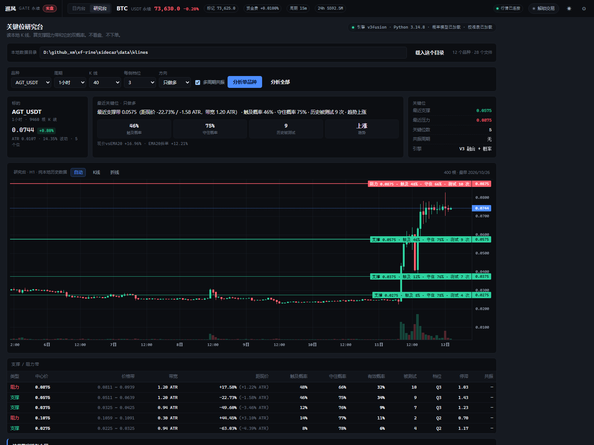
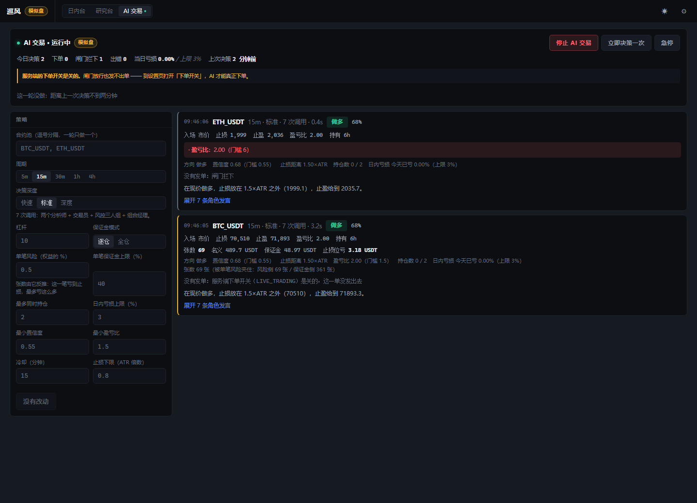

# 巡风 · 永续日内台（Gate / Bitget）

单人在本地跑的交易终端。看 K 线、看算出来的支撑阻力价格带、手动下单并自己填止损止盈。
另有一个研究台：读本地 K 线，算支撑阻力带和它的双概率，全市场扫描。





## 能做什么

- 连接 Gate.io USDT 永续合约，公共行情走 WebSocket，实时更新当前 K 线；图表可上下左右自由拖动并延伸到未来空白区，手机端请求设备支持的高刷新率（优先 120Hz，兼容 60Hz）。
- 跟随只在视口贴着最右边时发生：往回翻历史时来新 K 线，画面一根都不动（关掉了图表库默认的「每根都整体左移」）。
- 从 K 线里识别支撑位和阻力位，每个位给出价格带、距现价多远、历史触及次数和守住比例。
- 分箱宽度跟着 ATR 走，成交量按覆盖的箱摊进去，越老的 K 线权重越低；区宽夹在 0.3~1.2 个 ATR 之间。
- 摆动点用 ATR 阈值确认，破位后角色互换的价位也算进来；出结果前做间距抑制，不会给出一堆彼此重叠的位。
- 识别结果不冒充概率：排序分只有触及次数和陈旧度两个因子，「价格容易停」的倾向单独输出。- 手动下单、市价平仓、挂价格触发单做止损止盈。
- 持仓上套用自动方案覆盖旧的保护单，也可以自己填，或者干脆不设。
- 挂着的委托能改价改量，加仓和反手都在持仓卡里点。
- 图上画线，画完自动存浏览器本地。
- 抓当前币种的新闻，按相关度和时间排出来，再算一个情绪分。
- 从 K 线里认出经典形态（判定用 cm45t3r/candlestick，吞没、锤子、星辰、三兵三鸦等），在 K 线下方点一个圆点。点只标位置、不主张方向 —— 7 万根实测里没有一个形态有经得起校正的方向增量（见「K 线形态」一节）；十字线停上去能看到这一根是哪一种、实测胜率多少，图下另有一条「最近形态」。
- 图上标出算出来的支撑阻力：当前档位用绿/红线，只显示触及和守住概率；历史档位保留同色虚线，不显示文字。
- 持仓的**强平价**画在图上的虚线，仓里也会写一行 —— 逐仓时那就是这一笔能亏到的底。

- 图上标出真实持仓的成本均价和挂着的限价单，以及左上角那块的已盈亏：多少张、开仓价、标记价、赚亏多少。
- 左上角那块持仓摘要上直接能按市价平仓（两步确认）—— 手机上不用再滑到底下的持仓卡。
- 止损止盈被交易所到点撤掉这件事会写在脸上：保护单还剩多久到期、临期变红、一张都没有就标「裸仓」。
- 往回拖到最左边会自动补更早的 K 线，一次 1000 根，视口不跳。
- 把技术面和新闻面一起交给大模型，给一个偏多、偏空或观望的判断，并指出矛盾在哪。
- 深色、浅色两套配色，一键切换，K 线图的底色和网格跟着换。

下面这几条来自「研究台」，也是这次把上游项目整套搬过来的部分：

- 每个关键位给两个概率：**触及概率**（未来若干根内价格会不会走到这里）和**守住概率**（走到之后是反弹还是跌穿），
  界面上两个都写，不合并成一个说不清的「胜率」。
- 多周期共振：同一个品种的其他周期各算一遍，同一个价位在几个周期上都成立就标出来。
- 全市场扫描：一个目录里几十上百个品种一次算完，按「触及 × 守住」排序，点一行进单品种深度分析。
- 本地 parquet / csv 直接读，三种文件名约定（`{品种}主连_{周期}`、`{品种}_{周期}`、`{代码}_daily`）都认，
  时间戳是秒、毫秒、还是「秒 ÷ 1000」都自动判。
- A 股数据走复权路径（有权威因子就用，缺了会明说「这份是不复权」），不会因为除权跳空把关键位算歪。

## 需要什么

- Node.js 22 或更高版本。
- pnpm。
- **Python 3.10**（本机开发和 Android 打包需要，手机用户不需要另装 Python）。
- 交易所的 API 密钥，Gate.io 或 Bitget 二选一。在交易所的「API 管理」里创建，权限勾选
  **合约交易 · 读写**，不要开提现权限。不交易、只看研究台的话可以不配。

## 启动

```bash
pnpm install
pnpm build          # 打包前端，产物在 web/dist
pnpm start          # 启动服务，http://127.0.0.1:8787
```

开发模式用 `pnpm dev`。它会同时起前端热更新（5273 端口）和后端（8787 端口），前端把 `/api` 和 `/ws` 转发给后端。

Windows 上直接双击 `start.bat` 也行。

### 引擎（Python）

关键位算法使用 Python、NumPy 和 Pandas。电脑上由独立 Python 进程提供回环 HTTP 接口；Android APK 使用 Chaquopy 内嵌 Python 3.10 和这套引擎，手机后端通过本机回环接口调用。
第一次要建一次虚拟环境：

```bash
python -m venv sidecar/.venv
sidecar/.venv/Scripts/pip install -r sidecar/requirements.txt   # Linux/macOS 用 sidecar/.venv/bin/pip
```

引擎是**懒启动**的：第一次要算关键位时才拉起来，端口和口令都是随机的，只绑 127.0.0.1。
只想看盘、不需要档位的人可以不装，交易台的其它功能不受影响 —— 只是档位区会写明「引擎未就绪」。

一行命令自检引擎和数据层：

```bash
sidecar/.venv/Scripts/python sidecar/cli.py health
sidecar/.venv/Scripts/python sidecar/cli.py analyze --dir sidecar/data/klines --symbol BTC_USDT --tf D1
```

## 引擎与研究台

### 为什么要单独一个进程

算关键位的是上游项目 **Detect_support_and_resistance_levels** 的原版实现（V3 融合算法 + 双概率模型 +
评分标定表）。这部分用 numpy/pandas 写，搬进 Node 只能重写一遍，而「重写一遍」和「移植」是两件事：
以后上游改了参数、重训了模型，重写的版本对不上，也没法验证。

所以：**Python 只负责算，Node 只负责接口和界面**。两边用回环 HTTP 通信，各自管各自的进程。
Python 崩了不会把交易台拖下来，交易台的请求也进不了 Python 的解释器。

### 两条数据来源，同一个引擎

| 来源 | 怎么走 | 用在 |
|---|---|---|
| 交易所实时行情 | 服务端把已收盘的 K 线喂给引擎 | 日内台的档位带、图上的线、AI 快照 |
| 本地 parquet / csv | 把目录和品种名交给引擎，它自己读文件 | 研究台的深度分析、全市场扫描、AI 快照之外的离线研究 |

两条路算出来的是同一套东西，区别只在 K 线从哪来。距离都按「离现价多远」重算，现价的定义不同：
实时行情用最新成交价，本地数据用最后一根收盘价。

### 研究台在做什么

页面顶栏切到「研究台」（地址栏 `#research` 直接进）。它和数据目录、品种/周期都和日内台共用一份：

- 日内台的「本地数据」条上选目录 / 品种 / 周期，研究台切过去就是同一份；反过来也一样；
- 研究台第一次打开之后一直挂着，切回日内台再切回来，分析结果和扫描结果都还在。

选一个数据目录，它会：

1. 列出目录里的品种和周期，自动分析当前选中的那个品种；
2. 单品种深度分析：三张卡（标的 / 最近关键位 / 关键位统计）、K 线叠加档位、逐位明细表；
3. 全市场扫描：按有效概率排序，支持筛选、分页，点一行进单品种分析。

数字的口径写在页面上，不靠猜：

- **触及概率**：未来若干根内走到这个位的概率。上游在 130 只训练 + 130 只互斥测试股票上实测
  AUC 0.77 / 0.73（支撑 / 阻力），区分度强。
- **守住概率**：走到之后反弹而不是跌穿的概率。AUC 只有 0.59 / 0.61 —— 区分度弱，
  但校准很好（模型说 75% 的那批实际 75.4% 守住）。所以它的绝对值可以看，**不适合用来比较相邻两条位**。
- **有效概率** = 触及 × 守住，扫描表按它排序。
- **Q1~Q5**：这条位的强度落在历史第几档。分档线和「该档在样本外的实测守住率」来自上游在 A 股日线上的
  标定样本，搬到加密/期货上只能当参照，不是这里的胜率。
- **共振**：这条位同时在哪些周期上成立。

### 训练与回测

上游那套评测框架一起搬过来了（`sidecar/scripts/`）：

```bash
# 走查回测：产出 levels_*.parquet / geo_*.parquet / report.txt
sidecar/.venv/Scripts/python sidecar/scripts/run_eval.py --quick \
  --data-dir <你的 A 股数据目录> --out out/eval

# 用上面产出的 levels parquet 重训双概率模型
sidecar/.venv/Scripts/python sidecar/scripts/train_probability.py out/eval --out data/prob_models.json
```

数据目录可以用 `--data-dir` 指定（也认环境变量 `XFRINE_ASHARE_DIR`），复权口径用 `--adjust`
（`factor` 用权威因子 / `none` 不复权）。自备数据或合成数据跑评测时用 `--adjust none`。

其它脚本：`build_factors.py`（构建复权因子缓存）、`prob_model.py` / `prob_scale_period_exp.py`（概率模型对照实验）、
`score_search.py`（排序因子搜索）、`check_adjustment.py` / `validate_adjustment.py` / `eval_heuristic.py`（复权口径验证）。

### 接口

| 接口 | 说明 |
|---|---|
| `GET /api/research/health` | 引擎自检：模型、校准表、Python 版本 |
| `GET /api/data/dir` · `POST /api/data/dir` | 读 / 设本地数据目录（写只认本机）。研究台和日内台共用这一份 |
| `GET /api/research/analyze` | 单品种深度分析（`symbol` / `tf` / `n_zones` / `direction` / `mtf`） |
| `GET /api/research/scan` | 全市场扫描，按有效概率排序 |
| `GET /api/levels` | 日内台用的档位（`source=gate` 实时 / `source=local` 本地） |

### 打包

桌面安装包会把引擎一起打进去，用户机器上不需要装 Python：

```bash
pnpm pack:win      # 先打前端，再用 PyInstaller 打引擎，最后 electron-builder 出安装包
pnpm pack:sidecar  # 只打引擎（产物在 sidecar/dist/xfrine-sidecar/）
```

代价是安装包大了不少（numpy / pandas / pyarrow 跟着进去）。开发态和仓库里跑仍然用 `sidecar/.venv`。

## K 线形态

图上那条「形态」开关打开后，页面会从 K 线里认经典形态，在图下方点一个紫色圆点。点只表示
「这一根出现了经典形态」，不表示看涨还是看跌 —— 理由见下面「为什么不再标方向」。
十字线停到某一根上，左上角角标写出这一根是哪一种形态、实测胜率多少；
图下那条「最近形态」列最近 10 个，新的在前，每条都带「实测 / 基准」两个百分比。

判定规则用 [cm45t3r/candlestick](https://github.com/cm45t3r/candlestick)（MIT），源码 vendor 在
`web/src/lib/candlestick/`，不是自己手写的阈值。库一共 29 个判定（25 种形态，同一个形状按实体方向
分出几个 id），我们全跑。

### 为什么不再标方向

库自己的 `patternMetadata` 就写着 confidence 是「与上下文无关的固定值、已废弃」。以前展示压在这张表上
（strong 直接上图、moderate 过趋势门槛才上图），跑下来等于一个吞没探测器 —— 展示出来的 97.6% 只是
「吞没 + 光头光脚」。

换成实测（`pnpm stats:patterns`，70456 根真实 K 线，BTC / ETH / DOGE / SOL × 5m / 15m / 1h / 4h / 1d，
2019-11 ~ 2026-11，Gate 永续）之后更不好看：

| 形态 | 样本 | 方向正确率 | 同期基准 | 增量 | z |
|---|---|---|---|---|---|
| 看涨吞没 | 5916 | 46.3% | 49.2% | −2.9pp | −4.42 |
| 看跌吞没 | 5947 | 48.2% | 50.8% | −2.7pp | −4.10 |
| 光头光脚阳线 | 1332 | 44.9% | 49.2% | −4.3pp | −3.13 |
| 看跌孕线 | 6219 | 51.7% | 50.8% | +0.9pp | +1.47 |

25 个形态里**没有一个**通过 Benjamini-Hochberg 校正（FDR 10%）。最显著的几个是负的，而且涨跌两侧
一起偏 —— 这是「反转类形态」的通病（反转的反面就是趋势延续），不是某一个形态的参数问题。

所以处理方式分两层：

- **位置照标、方向不标。**「这里出现过吞没」是事实，可以标；「吞没＝看涨」是数据不支持的结论，不标。
- **数字摆出来。** 角标和图下列表都给「实测胜率 / 同方向基准 / 样本数」，谁都能自己判断该不该当真。

这里刻意没有按门槛把标记全关掉：实测一个都过不了线，那样开关就是个死功能。位置本身有信息。

### 几条口径

- 形态标在**确认那根**上。库返回的是形态的起始根，两/三根形态要往后数一格。
- 同一根只标一个：三根的优先于两根的，同长度取统计档位高的，再取方向增量更好的，
  最后才看库给的有效置信度。
- **趋势灵敏度按周期标定。** 库的公式是 `0.5 + 灵敏度 × SMA 单根涨跌百分比`，量纲随周期变：
  写死默认的 5 时，5m 上中位数只有 0.50（几乎全拒）、1h/1d 上直接饱和到 1.0（门槛形同不设）。
  现在按「让本周期 p75 的对齐度落在 0.9」反算，1m / 30m / 8h 这些没统计的周期按时间尺度借邻近周期。
- **分级稀疏化。** 有统计档位的隔 3 根标一个，没有的（占绝大多数）隔 6 根。实测图上密度约 **10%**，
  一屏 100 根 10 个点。以前是 12%~17%，构成本来全是吞没，现在能看到孕线、锤子、镊子这些。
- 扫描是分段的：补历史、来新 K 线、到上限裁头，各自只重算受影响的段
  （库整段扫 4000 根要 100~230ms，跟着 300ms 的行情刷新跑不起）。
- 踢线、流星、上吊线、曙光初现这几条规则要求真实跳空。加密永续 24/7 连续报价，所以很罕见：
  70456 根里合计 118 次（0.17%）。判断这批形态要用足够大的样本，否则真实跳空会被当成不存在。
- 升级库：把 `src/*.js` 按 `web/src/lib/candlestick/README.md` 里的机械转换重新 vendor 一遍，不要手改规则。

### 统计怎么重新生成

```bash
pnpm stats:patterns                 # 从 Gate 拉 4 个合约 × 5 个周期，3 折滚动，写 web/src/lib/patternStats.ts
pnpm stats:patterns --intervals 5m,1h
pnpm stats:patterns --folds 4       # 折数，默认 3
pnpm stats:patterns --refresh       # 忽略本地缓存
```

生成物 `web/src/lib/patternStats.ts` 是整份覆盖的，文件头写着样本区间和折法，别手改。默认把 5 个周期并成
一份统计：分周期的话最短的那个只有两千根，十几个形态摊下来每个只剩几十次命中，z 值没有分辨力。

口径：第 i 根收盘确认，持有 1/3/5 根（主口径 3），收益按方向对齐后除以当根 ATR/收盘价；
基准按方向分开算（看涨形态比「随便做多」，看跌比「随便做空」），混着算会得到恒等于 50% 的基准，
牛市里所有看涨形态都会显得很准。

### 为什么是折外结果

同一段数据既选又验会凭空多出发现：7 万根、25 个形态、5 个周期，一共产出 125 个假设，
跑出 1 个 z=1.82。那正好是假阳性的期望个数。

滚动多折把选择和验证分开：

```
折 1: [----- 训练 -----][- 测试 -]
折 2: [-------- 训练 -------][- 测试 -]
折 3: [----------- 训练 ----------][- 测试 -]
```

每折只在训练段上选（段内做 BH 校正），在**之后的**测试段上验。训练段最后几根拿不到之后的行情，
就不算收益、不进样本。最后各折测试段合并，得到的是「选的时候没见过的那部分数据」上的表现。
训练段的数字只写进命令行报告，不入表。

结论：3 折的训练段（3.5 万 / 4.7 万 / 5.9 万根）里**一个形态都选不出来**，所以测试段没有可验的东西。
折外结果里的增量全部为负或接近于零（看涨吞没 −3.5pp、看跌吞没 −3.8pp）。

**「全 0 选中」本身不能证明形态无效**——也可能是闭环坏了、真信号也选不出来。所以配了一份阳性对照
`pnpm check:patterns-walk`：喂人造的「形态出现后必涨」行情，要求闭环选得出；再把它打乱时间顺序，
要求 15 次折跑基本选不出东西。当前结果：人造信号训练 21.6pp → 测试 20.9pp（认得出），
打乱因果后选中 **0** 个（不无中生有）。

自检：`pnpm check:patterns`（形态映射、教科书形状、确认根位置、统计表自洽与折外、趋势灵敏度标定、
识别口径与展示口径的差别、增量扫描与整段重算一致，共 23 条）。


## 手机上用

手机 App 可独立运行：APK 内含 Node 服务端、Python 3.10、NumPy、Pandas 和支撑阻力引擎。
行情、关键位计算、账户配置和模拟盘测试都在手机本机完成，不需要电脑在线，也不需要手机另装 Python。
手机上的密钥和电脑端配置分别保存在各自设备。

启动后 App 会依次启动内嵌 Python 引擎和 Node 服务端。无法启动时可重试，也可填电脑端地址和访问口令作为连接方式。

手机上打开时：

- 760 宽以下换成单列：顶栏吸在顶上，K 线固定高度，下面的卡片一路往下排，整页纵向滚动。原来是把三栏压进一屏、各自滚动，屏幕一窄就挤成三条竖条。
- 1180 宽以下左栏收成抽屉：点顶栏左上角的 ☰ 打开，选完自动收，点遮罩或抽屉里的 × 也能收。原来是直接把左栏藏掉 —— 平板上因此根本没有换合约的入口。
- 顶栏在手机上只留环境徽标、币种价格、涨跌幅、行情连接点、解锁交易和设置。标记价、资金费、周期、24 小时量这几项收起来，图表下面那排档位卡里有更细的数。
- 按钮、筹码、输入框按手指放大一档；输入框字号 16px，iOS 聚焦时不会把整页放大。
- 画线工具条和关键价位带本来就是横向滚动的，手机上直接左右划。

## 打包成安装包

现成的安装包在 [Releases](https://github.com/xiaofengxfc/xf-rine/releases)。

自己打就两条命令，产物落在本机（安装包不进 git，见上面的说明）。装完之后不用装 Node，也不用开黑框。

### 电脑端（Windows）

```bash
pnpm install
pnpm pack:win
```

产物：`desktop/release/XunFeng-<version>-Setup.exe`。双击安装，桌面和开始菜单里出现「巡风」。

装进去的是一个壳，不是把页面拷一份进去：Electron 自带 Node，服务端被 esbuild 打成一个
2.8 MB 的 `server.cjs`，前端产物放在 `resources/web-dist`。启动时主进程先把服务端拉起来，
等 `/api/health` 通了才开窗口 —— 所以浏览器、手机 App、桌面窗口跑的是同一份前端、同一套接口。

| 东西 | 位置 |
|---|---|
| 程序 | 安装时选的目录（默认 `%LOCALAPPDATA%\Programs\xunfeng`） |
| 密钥、配置 | `%APPDATA%\巡风\.env` |
| 日志 | `%APPDATA%\巡风\app.log` |

- 端口默认 8787，被占了自动往下找（8788、8789…），挑到的那个记在 `.env` 的 `PORT` 里，下次接着用。
- 第一次启动会往 `.env` 里补两行：`HOST=0.0.0.0` 和 `REMOTE_TOKEN=随机口令`。这两行是给手机用的，见下一节。
  Windows 会因此弹一次防火墙，要允许<b>专用网络</b>，否则手机连不进来。
- F12 打开开发者工具。窗口缩到 760 宽以下就是手机上的排法，调样式不用开真机。
- 卸载不删 `%APPDATA%\巡风\`，重装回来密钥还在。

### 手机端（Android）

```bash
pnpm install
pnpm pack:android
```

产物：`mobile/android/app/build/outputs/apk/release/app-release.apk`（当前约 67 MB，arm64）。APK 内包含 Python 数值运行时和 Node 服务。
系统要求 Android 7.0（API 24）及以上，且只打 arm64（Android 包里的架构由 `build.gradle` 的 `abiFilters` 决定）。

打包机要有 JDK 17 以上、Android SDK 和 Python 3.10。脚本按 `JAVA_HOME` / `ANDROID_HOME` → 仓库里的 `.toolchain/jdk`、`.toolchain/sdk`
→ Android Studio 自带 jbr 的顺序找，都没有才报错，并说清该设哪个变量（见 `mobile/tools/gradle.mjs`）。
若 Python 3.10 不在默认 `python` 命令下，可设置 `CHAQUOPY_BUILD_PYTHON` 指向对应的解释器。

APK 内含 Node 服务端和 Python 支撑阻力引擎。首次启动会初始化本机服务，手机可独立使用。

- 本机服务启动后直接进入交易台。手机可以在设置中配置交易所密钥并切换模拟盘。
- 本机服务启动失败时可重试，也可以选择连接电脑端。
- 全面屏按「画到系统栏底下、自己让位」来排：页面写 `viewport-fit=cover`，壳把系统栏和挖孔的尺寸
  注入成 `--safe-area-inset-*`，页面里统一用 `--inset-*` 这四个变量（见 `web/src/styles.css` 开头）。
  少写那句 viewport，手机上就会白留上下两条边 —— 这就是 `env(safe-area-inset-*)` 全是 0 的样子。
  顶栏、抽屉、弹窗、提示条和启动界面都按这个让位，横屏也认左右挖孔。
- 手机上什么都能改：密钥、环境、下单开关、持仓模式。没有「只能看盘」的限制。
- 密钥存在 App 自己的目录里，和电脑那份互不相干；改一个不影响另一个。
- 交易所如果开了 IP 白名单，要填的是**手机**的出口地址（实盘页那一格显示的就是它）。换个网络就会变，
  手机走流量和走 Wi-Fi 出来的地址不一样。

手机独立端的密钥和环境存在手机自己的 App 私有目录。连接电脑端时，编辑的是电脑那份配置。

#### 连不上的时候看哪里

本机服务启动失败时会显示 Python 或 Node 的错误，并提供重试入口。选择连接电脑端后，连接页会报告口令错误、地址不可达或服务身份不匹配等原因。

连电脑查的话：`adb shell am start -n com.xfrine.terminal/.MainActivity`，
截屏 `adb exec-out screencap -p > x.png`（或者 `screencap` 到 /sdcard 再 `adb pull`）。
**别指望 `adb logcat`**：小米/Redmi 这类系统对 adb 关着日志，`logcat -g` 里三个 ring buffer 全是
`0 B readable`，Node 的输出一行也拿不到 —— 所以启动过程才要往页面上送一份。

签名用的是自己生成的密钥：`mobile/android/keystore.properties` 和它指的那个 `.keystore`，
两个文件别丢。换了签名，已经装过的手机不能覆盖升级，只能卸载重装。

### 自动更新

装好的程序每次启动会查一次 GitHub 的 Release，有新版就弹窗，内容就是那一版的更新说明。
点「稍后更新」只关掉这一次，下次启动还会提示。

- **电脑端**：「开始更新」下载安装包、校验 sha256，然后静默安装并自动打开新版本。
  安装器带 `--updated /S --force-run`：复用原来的安装目录，`%APPDATA%\巡风` 里的密钥和设置不动。
- **手机端**：安卓不允许应用自己静默安装，所以按钮是「下载安装包」：用系统浏览器下载 APK，
  下载完点开它，由系统安装器确认。签名没换就能覆盖升级。
- **刚升级完**：第一次启动会弹这一版的更新说明；判据是上次启动的版本比现在低。

更新源就是这个仓库的 Release。仓库是公开的，客户端匿名读取就够 ——
安装包里不带任何令牌，拿到安装包的人也拿不到别的权限。

私有 fork 想沿用同一套更新：打包时设 `XF_UPDATE_TOKEN`（细粒度只读令牌），
请求会带上它；不设就走匿名。匿名接口限每小时 60 次，一次启动只查一次，够用。

离线、限流、那一版没写说明，都不影响程序启动；启动日志里「更新」那一行写着版本号和状态。
自检不联网：`pnpm -F server check:update` 管版本比较和挑安装包，
`pnpm check:update-flow` 管「这次该弹哪个窗口」。

### 数据存在哪

三种跑法各存各的，谁也不读谁的：

| 跑在哪 | 密钥和配置 | 说明 |
|---|---|---|
| 电脑安装版 | `%APPDATA%\巡风\.env` | 卸载不删，重装回来还在 |
| 电脑端开发态（`pnpm -F desktop start`） | `%APPDATA%\巡风-dev\.env` | 调界面时用，改坏了不影响装好的那份 |
| 手机 App | App 私有目录中的 `.env` | 手机自己的密钥和配置，与电脑端分开保存 |
| 仓库里跑（`pnpm start`） | `server/.env` | 开发用，和上面几个无关 |

入口都是同一个环境变量 `XFRINE_HOME`，没设就退回「服务端自己所在目录的上一级」。
设置页最下面那格会写明当前用的是哪个路径 —— 对不上就是没按预期启动。

### 打包时踩到的坑

打包本身不动业务代码，但会把平时看不见的问题翻出来。下面这些已经处理掉了：

| 现象 | 原因 | 怎么处理 |
|---|---|---|
| 装完白屏 | 服务端按「自己所在目录往上两级」找 `web/dist`，打进安装包后这个相对路径不存在 | 桌面端用 `WEB_DIST` 指到 `resources/web-dist`；找不到就往日志里写明，不留一块黑屏 |
| 设置页存了密钥，重启就没了 | `dotenv/config` 只读进程当前目录下的 `.env`，而安装目录是只读的，写不进去 | `.env` 改存 `%APPDATA%\巡风\`（`XFRINE_HOME`），dotenv 显式读这个路径 |
| 和别的程序抢 8787 | 端口写死 | 先探 8787，被占就顺下去找空的；挑到的端口记进 `.env` |
| 安装版连到了开发环境，改密钥写进项目的 `server/.env` | `portFree` 只是「试着绑一下」，而 Windows 允许别人绑着 `127.0.0.1:8787` 时我们再把 `0.0.0.0:8787` 绑成功：两个进程同时监听，`127.0.0.1` 的请求优先给更具体的那个，页面于是接到了别人 | 探端口改成「先连一下，连得上就是有人」；起完子进程还要对 `/api/health` 带回的随机标记（`XFRINE_INSTANCE`），对不上就换下一个端口重来。冒烟测试也顺带核对页面标题，端口上坐着别人的页面不算过 |
| 开发版和装好的那份共用一套密钥 | 两处都取 `app.getPath('userData')`，名字一样 | 开发态（未打包）在后面加 `-dev`，各存各的 |
| 窗口关了，端口还被占着 | 服务端是子进程，主进程退了它不一定退 | `before-quit` 和 `process.exit` 两道都杀它 |
| 双击第二次，开出第二个窗口 | 没做单实例 | `requestSingleInstanceLock`：第二个实例把第一个窗口顶到前面就退 |
| 手机浏览器打开一片空白，接口 401 | 页面在 `http://localhost`（或 `https://…`），接口在 `http://192.168.x.x:8787`，跨域和口令两道都没过 | `/api` 加 CORS 和预检；从别的机器来的请求要 `x-remote-token`，口令在电脑设置页里 |
| 手机 App 一片空白 | 页面是 `https://localhost`，请求 `http://127.0.0.1:8787` 被判成混合内容，直接掐掉 | `server.androidScheme` 改成 `http`，清单里加 `usesCleartextTraffic` |
| APK 首次启动时间较长 | Node 和 Python 数值库在 App 内初始化 | 启动画面报告服务端启动失败或 Python 引擎启动失败，可重试或连接电脑端 |
| 按返回键直接退出程序 | 安卓默认行为 | 先关浮层（设置页、左上角抽屉），没人接手才退出 |
| `pnpm pack:win` 报成功，`release/` 里还是上一次的安装包 | 脚本写的是 `-F desktop`，桌面端的包名其实叫 `xunfeng`。pnpm 找不到只警告一句，退出码照样 0 | 过滤条件改成按目录：`pnpm --filter ./desktop dist`（手机端同理用 `./mobile`）。改完看 `release/` 的时间戳，别信退出码 |
| 往回拖 K 线，一页要干等一两秒 | 服务端按「合约:周期:根数:before」缓存整页、四秒就过期，同一段历史拖回来还得再问一次交易所（实测 1.4~4 秒） | 改成按「合约:周期」攒一条时间轴：已经拉过的区间直接切一段出来，实测 4 毫秒；只有要的窗口确实在时间轴外面才去补一页 |
| 往前翻一段后左边一直是空的，像 K 线残缺 | 前端一边并一边 `slice(-3000)`，刚补进来的那页当场被挤掉；补到上限后根数不再变，又掉进「只写最后两根」的增量分支，补来的历史根本没画 | 到上限就不补了（宁可不加也不删），并进来的一律整段重画；翻页改成一页 1000 根，上限两万根 |
| 补历史时画面先「转移」一下才显示 K 线 | 两个来源：挤掉最老数据后视口稳不住，被弹回最新一屏；以及「拿到更旧快照」那条路会调 `fullLoad()` 重置视口 | 两种情况都不再动视口。拿 5.2.1 的库实测过：`setData` 前面插一千根，可见时间一秒不变（逻辑区间自己从 0~160 变成 1000~1160），所以任何「按根数平移」都是帮倒忙 |
| 停一下再拖，接缝处少一根 K 线 | Gate 的 `to` 是闭区间：`to=X` 会带回 X 那根，把它当重复切掉，那一段就少一根 | 要「X 之前的 N 根」就把 `to` 往前挪一根（`to = X - 周期`），正好 N 根，接缝严丝合缝 |
| 翻到最老报 400 `Candlestick too long ago` | 交易所只留最近一万个点（1m 约七天） | 服务端把这条当「到头了」：回空页并记住别再问，前端看到不满一页就收手，不再报错 |
| `pnpm pack:android` 一上来就报 `JAVA_HOME is not set` 或 `SDK location not found` | gradlew 只认 `JAVA_HOME`（或 PATH 上的 java），而 `android/local.properties` 不进版本库；仓库里其实带着 `.toolchain/jdk` 和 `.toolchain/sdk`，只是没告诉 Gradle | `mobile/tools/gradle.mjs` 按 `JAVA_HOME` → 仓库 `.toolchain` → Android Studio 自带 jbr 的顺序找 JDK，SDK 按 `ANDROID_HOME` → `local.properties` → 仓库 `.toolchain` 的顺序找，顺手把 `local.properties` 补上；找不到就直说该设哪个变量 |

| 手机上下各留一条边，内容不铺满 | 页面没写 `viewport-fit=cover`，`env(safe-area-inset-*)` 就全是 0，壳按「缩进去」排 | 页面写 `viewport-fit=cover`，壳把系统栏尺寸注入成 `--safe-area-inset-*`（`SystemBars` 插件），页面统一用 `--inset-*`；壳的 `initialViewportFitValueHint: 'cover'` 让首帧就按整屏排，不跳一下 |
| 状态栏图标颜色和页面主题对不上 | 壳的默认值看的是**系统**深色/浅色，页面主题是自己选的 | `web/src/lib/theme.ts` 的 `syncSystemBars()` 在切主题时调 `SystemBars.setStyle`（深色底配浅色图标，反之亦然） |
| `pnpm pack:win` 报 `connect ETIMEDOUT 20.205.243.166:443` | electron-builder 从 GitHub 取 Electron 压缩包和 winCodeSign，用它自己的 got；Node 不读系统代理，机器上代理开着也帮不上 | `desktop/tools/builder.mjs` 读一次 Windows 系统代理（和 `server/src/net.ts` 同一个来源）塞进 `HTTPS_PROXY` 和 `ELECTRON_GET_USE_PROXY`；第一次失败原样再来一次 |

## 第一次配置密钥

1. 打开页面，点右上角齿轮。
2. 设置页分成「模拟盘」「实盘」「AI」「外观」「反馈」五页，密钥各填各的，留空表示不改。
3. 点「接口体检」。读到账户权益就是通了。

两套密钥存在 `server/.env` 的四组变量里（`GATE_TESTNET_KEY/SECRET` 和 `GATE_LIVE_KEY/SECRET`），互不覆盖。**填哪一套都不会切环境** —— 切环境是实盘页里那个单独的按钮。

保存后立即生效，不用重启。密钥只写进 `server/.env`，只有服务端读，页面拿到的永远是尾号四位。

### 换交易所（Gate / Bitget）

设置页最上面那两个按钮二选一，同一时间只连一家。

两家都做 USDT 永续，页面上的「张」在两边是同一个意思：1 张 = 该合约的乘数（BTC_USDT 都是 0.0001 个 BTC）。
交易所自己的口径差别在接线那一层翻掉了，看盘、下单、平仓、保护单的流程不变：

|  | Gate | Bitget |
|---|---|---|
| 密钥 | KEY + SECRET | KEY + SECRET + **PASSPHRASE**（创建密钥时自己设的那串） |
| 变量 | `GATE_LIVE_KEY/SECRET` | `BITGET_LIVE_KEY/SECRET/PASSPHRASE`（模拟盘那套同理） |
| 模拟盘 | 单独域名 `api-testnet.gateapi.io` | 同一个域名，请求头带 `PAPTRADING` |
| 周期 | 有 8h | 没有 8h，页面只列它有的那几个 |

换一家等于换一个账户：服务端会把解锁令牌、AI 交易、下单开关一起清掉，密钥各存各的，切回去不用重填。
`EXCHANGE=gate|bitget` 就写在 `server/.env` 里，设置页点一下改的就是这一行。

Bitget 配完先跑一次自检，它会把三把钥匙、合约元数据、账户、持仓、挂单、保护单一条条打出来：

```bash
pnpm -F server check:bitget          # 只读，不动账户
pnpm -F server check:bitget --order  # 再挂一张现价一半的限价单并立刻撤掉，验下单权限
```

Bitget 的 REST 和行情 WebSocket 跟着同一个出网决定走：直连被重置的网络里会自动走系统代理，
两边都由 `server/src/net.ts` 选路。行情断了页面顶上会显示「行情断开」，不需要手动重连。

**行情走哪条路会自己纠正。** REST 和小包请求能走通，不代表长连接能走通 —— 代理节点掐 WebSocket、
TUN 把连接黑洞掉，都只影响后者。所以行情 WS 有自己的一套判断：

- 先按实测快慢挑一条（直连 / 代理），连上就记住这条；
- 12 秒还没握上手，或者连上 4 秒内就断，算这条路不通，**自动换另一条**；
- 连着 90 秒一帧数据都没有，就当连接假死，掐掉重连（TUN 掉线时 TCP 常常还举着）。

真嫌它挑错，`server/.env` 里写 `XF_WS_ROUTE=direct` 或 `proxy` 把它排在前面（另一条仍是后备）。
日志里每条断线都带 `route=`、`code=`、`uptime=`，看不懂时先看这三样。

这套判断有两条自检，改之前之后都该跑一遍：

```bash
pnpm -F server check:ws-route      # 选路 / 换路 / 假死判断，纯函数，秒级，不用网络
pnpm -F server check:ws-failover   # 真起服务端 + 本地假代理，跑五种场景（约两分钟，要能连外网）
```

`check:ws-failover` 覆盖的是：直连、代理正常、代理只掐 WebSocket、代理把 CONNECT 挂成黑洞、
上游连上却一帧不发。每一场景都断言「最终有行情帧进来」，而不只是「日志里出现了某句话」。

**实盘那一页有「当前 IP」一格。** 由浏览器自己查，走系统代理和 VPN，所以代理开着时显示的就是代理那边的地址。
右边的「复制」直接拷走。地址下面写着检测时刻，点「重新检测」会重新查一次并弹一条提示。

服务端自己读一次系统代理（Node 不读，程序替它读），查 IP 时跟着它走，所以两边显示同一个地址。

Gate 的行情和交易优先直连：直连最快，密钥白名单认的也是直连出口。直连不通才退回代理，
而且只对查询类请求重试 —— 下单、撤单重发一遍可能变成两单。这一格下面写着白名单该填哪个地址。

刷新不会把界面打回默认。记在浏览器本地的有：币种、周期、开仓比例（25/50/75/100）、左侧栏停在「全部/涨/跌」哪一页、搜索词、列表滚到哪、每个币种各自的图表视口。每个「币种:周期」的视口各记各的。

存的合约如果已经下架，会自动退回 BTC，不会卡在一个不存在的合约上。存的整份记录读坏了就当没存过，不会让页面起不来。

## 外观和反馈

**两套配色。** 齿轮左边那颗按钮一键切换（深色时显示 ☀，浅色时显示 ☾），也可以进设置页的「外观」页选。
默认深色，不跟着系统走 —— 盯盘的地方通常就暗着，被系统冷不丁刷成白底更刺眼。
选哪套记在浏览器本地，电脑和手机各记各的，换设备不会跟着走。

K 线的底色、网格、坐标轴、十字光标会一起换，因为 canvas 读不到 CSS 变量，得单独贴一次。
涨跌色和画线颜色两套一样：红的还是红的，绿的还是绿的。

窄屏上顶栏会优先保留行情、下单状态和设置入口。主题按钮收在设置页的「外观」页，图表高度会按实际顶栏高度自动铺满剩余视口。

**反馈直接寄到信箱，不用配邮箱。** 设置页「反馈」页填标题和内容，服务端用自己的 163 信箱寄出去；
页面上只显示收件地址和一个「复制」，没有任何要填的邮箱配置。信里附上当时的合约、周期、窗口大小和系统版本
—— 排问题时这几项最有用，密钥不会被带出去。

同一个地址 15 秒内只能发一封，一小时最多 10 封，挡的是误连点（一次点击就是一封真邮件）。
163 自己的发信频率限制照旧。

**授权码是明文写在 `server/src/feedback.ts` 里的。** 这是给本机自用的，源码不外发就没问题。
真要推到公开仓库，把那三个常量挪进 `server/.env`，用 `FEEDBACK_SMTP_USER` / `FEEDBACK_SMTP_PASS` / `FEEDBACK_TO` 覆盖
（代码先读环境变量，读不到才用内置那份）。

163 有两条要求，配错就发不出去：走 465 端口 SSL，密码填客户端授权码而不是登录密码，发信账号要和 `From` 一致。

## 模拟盘和实盘

设置页顶部的「当前环境」按钮选打哪个环境。当前是模拟盘。

切环境会顺手把下单开关关掉 —— 换到实盘意味着换成真钱，开关不该跟着一起过去。已经解锁的令牌也一起作废：换环境就是换账户，上一个账户的解锁不该带到下一个账户上。

| | 模拟盘 | 实盘 |
|---|---|---|
| 账户、持仓、下单 | `api-testnet.gateapi.io`，测试网假钱 | `api.gateio.ws`，真钱 |
| K 线、成交、ticker | 主网 | 主网 |
| 密钥 | 必须用测试网密钥 | 必须用主网密钥 |

行情永远取主网，因为测试网的行情是编造的：它的 BTC 24 小时成交量能报到 880 亿 USDT，K 线在图上是一堵乱墙。拿它做技术分析没有意义。所以两边分开取数据。

到 Gate 测试网建密钥：<https://www.gate.io/testnet> 。测试网账户的余额也是假的，可以在测试网页面自己充值。

从模拟盘切到实盘时，下单开关会自动关掉、解锁令牌作废，需要重新打开开关再解锁一次。

## 持仓模式

Gate 有单向持仓和双向持仓两种模式，账户在哪一种由交易所决定，页面上改不了。两种模式都支持。

| | 单向持仓 | 双向持仓 |
|---|---|---|
| 同一合约 | 只能有一个方向的仓 | 多空可以同时持有 |
| 读持仓接口 | 返回一个对象 | 返回两条：`dual_long` 和 `dual_short` |
| 平仓 | `auto_size: close_long` | 同左 |

平仓统一用 `auto_size`。老的 `close: true` 在双向模式下会被 Gate 直接拒绝（`POSITION_DUAL_MODE: close is not allowed in dual-mode`）。`auto_size` 两种模式都吃，所以只有一条代码路径。

双向模式下同一个合约可能同时有多头和空头持仓，页面按方向分成两张卡，平仓也只平指定的那一边。

## 下单要过的两道闸

两道都必须打开，缺一道服务端就拒绝下单。模拟盘里这两道照常生效，方便提前练熟流程。

| 层 | 位置 | 作用 |
|---|---|---|
| LIVE_TRADING | `server/.env` 或设置页的开关 | 关掉后服务端拒绝所有下单、撤单、改杠杆请求 |
| 解锁交易 | 页面右上角按钮 | 解锁后 10 分钟内可以下单，到点页面自己落锁并作废令牌 |

**程序不设任何仓位上限** —— 杠杆、张数、名义价值都不管，想开多大开多大。唯一的约束是账户保证金和交易所自己的规则：杠杆要在该合约的允许范围内，张数要在最小和最大下单量之间。这几条服务端会原样转达交易所的报错，不做二次加工。

去掉上限是有意的：这是给个人日内交易用的，仓位大小该由你自己按当天的行情决定，不该由一个写死的常量替你决定。

下单要点两次：第一次显示「确认下单」条，第二次才真的发出去。

**默认逐仓，全仓得自己点。** 交易所账户默认是全仓：一个仓亏穿了会继续吃整个余额，止损只护住一部分。
下单面板上是「逐仓 / 全仓」两个按钮，默认逐仓 —— 反过来（默认全仓）等于默认替你选了风险最大的那种。
模式不是纯前端的选择：Gate 没有单独的模式开关，`leverage` 传非 0 是逐仓、传 0 是全仓（杠杆放在 `cross_leverage_limit` 里）。
所以服务端在开仓前会先设一次，**设不成就不发单** —— 模式没切过来就开仓，止损护住的范围和你想的不是一回事。
这一边已经有持仓时不去动它（交易所也不让改），回执里会写明「模式沿用交易所现状」，页面会说一句。

**保证金不够时先把账说清楚。** 确认条上写着这笔连手续费要多少、可用多少、差多少，以及按同样的杠杆最多能做几张。服务端也会把 Gate 那句 `margin ... while available ...` 换成同样的账。判断仍然由交易所做，页面只是不再让你猜。

**盘口另一边是空的，也会说清楚。** 市价单被交易所的滑点保护拒掉时，Gate 回的是
`MARKET_PRICE_TOO_DEVIATED` 加两个价格，看不出该干什么。服务端把它翻成「盘口另一边没有能成交的价」，
并说明仓位本身没问题、过几秒重试或者去交易所网页手动平。这句最常出现在平仓上 —— 模拟盘的盘口经常是空的。

开仓张数按可用余额的比例算，面板上是 25% / 50% / 75% / 100% 四档。

**公式是「可用 × 比例 × 杠杆 ÷（每张名义 × (1 + 费率)）」**，按保证金口径。分母里带上手续费，
所以点 100% 时算出来的张数刚好卡在「保证金 + 手续费 = 可用余额」上，不会因为差几毛钱被交易所拒。

摘要里把账写清楚：名义价值、占用保证金、手续费、可用余额。比例算不到最小下单量、或者撞到合约上限时，
会直说是被谁夹住了，不悄悄换成一个看起来正常的数字。

**开仓时就能设止盈止损，也可以不设。** 两个框自己填，留空的那一边不挂。填到现价另一侧会直接拦下。

填了价之后，止损价、止盈价下面会直接算出**这一笔到价平掉是多少钱**，做多做空两列并排 ——
同一个止损价，做多是亏、做空就是赚，只看自己那一列看不出这件事。入场价跟着这一单走：
限价单用你填的限价，市价单用现价。算的是毛盈亏，不含手续费，旁边把开平两次的手续费估出来写在一起。

市价单成交后保护单立刻挂上。限价单还没成交的话，服务端先记着，等它成交、持仓一出现再挂上 ——
这一步靠页面每 3 秒的轮询，所以页面得开着。关掉页面之后才成交的单，只能到持仓卡补挂。
**止损止盈只挂上一半时会明说。** 交易所拒掉其中一张（价格不在它的最小变动位上、仓位不够等）时，回执里
是「保护只挂上了一边」加被拒的原因，不再笼统地说「保护单已挂」。

**数据停了会说。** 服务端没起来、或者交易所一直报错时，页面以前会一声不响地停在最后一份快照上 ——
仓位、均价、盈亏全是旧的，看起来就像「图上的均价线画错了」。现在持仓卡顶部会写「已经 N 秒没更新了」
加原因，图表右上角也挂同一句话，图上的持仓摘要压暗，并且停更时整块用快照自己的价格算（不拿新价格配旧持仓）。
失败的那次 1.2 秒后就会重试；切回标签页、窗口重新获得焦点、行情 WebSocket 重连成功时，都会立刻补刷一次。
服务端这边，漏网的异常和未处理的 Promise 拒绝只记日志，不再让进程直接退出。

## 持仓上能做什么

| 操作 | 在哪 | 做了什么 |
|---|---|---|
| 设止损止盈 | 持仓卡 | 自己填止损价和止盈价，两个都留空就只撤掉现有的 |
| 加仓 | 持仓卡 | 按市价在同方向加张数 |
| 反手 | 持仓卡 | 市价平掉这一边（连带撤掉这一边的委托和触发单），再按同样的张数开反方向 |
| 平仓 | 持仓卡 | 市价平掉这一边，连带撤掉这一边的委托和触发单 |
| 改单 | 委托页 | 改限价和剩余张数，改了之后撤旧单重挂 |

**已盈亏是页面自己按标记价现算的。** 式子就是交易所的口径：

```
(标记价 - 开仓价) × 张数 × 每张币数，空头取负
```

多空走同一个式子，所以两边的数一定对得上。这个式子不是猜的：在模拟盘上多空各开 1 张，算出来的数和
`/futures/usdt/positions` 返回的 `unrealised_pnl` 一分不差。

用标记价而不是最新价，是因为交易所本身按标记价算盈亏 —— 拿最新价算会和交易所差几个点，看着就像「数据不对」。
标记价从 WebSocket 的 `futures.tickers` 推下来，价格一动盈亏就跟着动；账户、持仓、委托、触发单每 3 秒从
`/api/private-state` 取一次（一个接口给全，四份数据来自同一时刻，不会出现持仓和它的止损单一新一旧）。

**挂保护是覆盖，不是叠加。** 每次挂都先撤掉这一边已有的触发单，再挂填了的。同一个方向留两套止损，到价时几张单一起打，会平出个反向仓。所以连点两次「设止损止盈」也安全。

**挂错方向的止损会被拦住。** 多头止损必须低于现价，空头止损必须高于现价。Gate 的触发单是到条件就市价平，止损挂在现价上方，挂上去那一秒就成交。

判的是「最新成交价」和「标记价」里更靠里的那个。触发单看的是最新成交价，标记价常常比它更靠内一点：
只按标记价判，止损正好落在两个价之间时照样一挂就成交 —— 用户看到的是「刚挂上就被平了」。

**改单会换委托号。** 服务端先把新价新量按下单同一套规则验一遍，验过了才撤旧单重挂。新价超出允许偏离、或者张数超过剩余量，旧单还在。张数按剩余量算，已经成交的部分不重挂。

**平仓会把这一边的委托一起撤掉。** 顺序是先平、后撤 —— 反过来的话，平仓万一被交易所拒了，保护单已经没了，仓就裸着。撤的是：

- 这一边的触发单（止损止盈）。仓都没了它们还留着，下次开同方向的仓，一出现就被它们打掉；
- 这一边的未成交委托。减仓单没仓了就没有意义；不带减仓标记的限价单留着，会在平完仓之后重新开出一个仓来 —— 你以为空仓，实际多了一个没人管的仓。

双向模式下同一个合约另一边还有仓时，只动这一边：那边还挂着自己的保护单和减仓单。整个合约都空着的时候才一张不留。回执里会写清楚撤掉了多少张，撤单失败也不挡平仓。

**平仓只成交一部分时，这一边的保护单不撤。** 盘口太薄、市价单只打掉一部分的时候仓还开着，把止损一起撤掉等于让剩下的仓裸奔。回执里会写明还剩多少张没平，剩下的仓和它的保护都留着。

**开新仓之前也会清一次孤儿触发单。** 上一个仓早就平了（比如被止损打掉），剩下的那张止盈单没有东西可平，却还挂在盘上；等同名合约的新仓出现，它第一时间就把新仓平掉。所以下开仓单时，服务端会先把这一边没有持仓可平的保护单撤掉。

**反手是两步。** 先市价平掉这一边，确认成交了才开反方向。平仓没成交就停手，不会多开一边。如果平仓成功、开仓失败，页面会说明现在这一边是空仓。

触发单的 `expiration` 是 86400 秒。挂上 24 小时后自动失效，要长期保护得重挂。

## 支撑阻力怎么算的

代码在 `server/src/levels.ts`，算法移植自
[Detect_support_and_resistance_levels](https://github.com/rosemarycox5334-debug/Detect_support_and_resistance_levels)
的 V3Fusion（`src/srlab/detectors.py`）。那套东西在 A 股上做过对照实验，取舍都有实测支撑。

流程：六路证据 → 融合出「定位面」找候选 → 每个候选定区宽、算历史守住率 → 排序 → 间距抑制。

| 证据 | 干什么 |
|---|---|
| 成交量剖面 | 箱宽 0.25×ATR（下限取合约最小变动价），一根 K 线的量按它覆盖的箱均摊，60 根半衰期做时间衰减 |
| 收盘价堆积 | 市场「认可」的价格比全区间更聚焦，用高斯核撒到邻近箱 |
| 枢轴聚集 | ATR 阈值 ZigZag，价格反向走 2×ATR 才确认这个极值；破位后角色互换的位保留 40% 贡献 |
| 历史守住率 | 同一次进入只算一次（5 根冷却），要求从正确方向接近，阈值按「当时」的 ATR 化 |
| 整数关口 | 原作者实测没有信息量，权重归零，函数留着便于对照 |
| 陈旧度 | 越久没被碰过越强 —— 和直觉相反，实测如此 |

**排序只用两个因子**：`log1p(触及次数) + 0.8 × 陈旧度`。原作者在约 38000 个已触及关键位上做过候选评分搜索：
成交量剖面的「守住率差 +8.98pp、收益率差 −0.88pp」—— 它测的是「价格会停」，不是「进场能赚」，
所以移出排序，单独作 `pStall` 输出。界面上两个数分开写，谁也冒充不了谁。

区宽由证据面的半高宽决定，再夹到 `[0.3, 1.2] × ATR`。不夹的话旧做法给出的区宽是 2.2~5.7 ATR ——
「守住率」就是这么刷出来的：区越宽当然越容易守住。

**因果性**：ZigZag 一次性跑完整条序列，但每个枢轴都记着「被确认的那一根」，`t` 时刻只允许用确认时刻不晚于 `t` 的枢轴。
等价于实时算，不碰未来数据（`pnpm check:levels` 会验这一条）。

**守住率不是概率保证**：事件少于 2 次时给的是保守下界 0.25；触及 3 次守住 3 次也不等于 100%。

### 本地数据（Parquet / CSV）

代码在 `server/src/localdata.ts`，接口是 `/api/data/*`，界面在图表上面那条「本地数据」。

上游的主用法就是「读一批本地 parquet 算位」，这条一样能用：选一个目录，里面放
`品种_周期.parquet`（也认 `.csv`），文件名里的周期认 `D1 / H1 / 15min / 5min / daily / 60min` 这几种写法，
列名认 `time / open / high / low / close / tick_volume`（`volume` 也行，大小写无所谓）。

- 时间单位按**整列**判一次（毫秒 / 秒 / 上游 A 股那种「秒÷1000」），不逐行猜 —— 逐行猜会让同一列里一半被乘 1000、一半被当秒，时间轴当场崩掉。
- 清洗：停牌行（量 ≤ 0）、结构性坏行（high < low 之类）丢掉；日线按自然日归一，同一天多条留最后一条。
- **不做复权**。上游那套复权是为 A 股除权设计的，这里没搬；拿它读没复权的 A 股 CSV，除权日的断层会原样进来。
- 选目录只在电脑上给（写接口是「读你硬盘」的入口，只认本机回环地址）；目录本身对局域网只读，
  这样手机上的研究台和日内台看到的是同一个目录。目录会记住，下次打开还在。
- 研究台和日内台共用同一个目录、同一对品种/周期：在任一边换，另一边切过去就是它。

## 移植说明和来源

算法（`server/src/levels.ts`）和数据层（`server/src/localdata.ts`）移植自
[Detect_support_and_resistance_levels](https://github.com/rosemarycox5334-debug/Detect_support_and_resistance_levels)
（作者 rosemarycox5334-debug，**GPL-3.0**）。

- 这两个文件以及因此受影响的整份代码，按 GPL-3.0 分发；原项目的许可和版权归原作者。
- **没有移植前端**：上游的界面是 Flask + Plotly 生成的 HTML，这里换成 React 自己画。
- **没有移植 Python 运行时**：上游是 Flask + Pandas/NumPy/SciPy。这套东西装不进 exe，也装不进 APK，
  而算法本身是纯数值计算，用 TypeScript 重写一份没有精度上的损失（`pnpm check:levels` 会验因果性、
  体积守恒、区宽夹逼等 8 项）。
- 标定表（`EDGE_EDGES / STALL_EDGES / EDGE_BUCKETS`）是从上游 `data/score_calibration.json` 原样抄的。
  那份样本是 **A 股日线**，搬到加密永续上只当参照 —— 界面上写的是「历史分位 Q1~Q5」，不叫胜率。
  上游自己也测过：输出的「下次守住概率」Brier 0.1836，常数预测 0.1842，等于零区分度，所以那个概率被删掉了。

## 止损止盈怎么填

面板上两个框，自己填，留空的那一边不挂。填到现价另一侧会被拦下 —— 那种触发单一挂上就当场成交，等于市价平仓。

判断用的是「这一单会成交在哪个价」：回踩挂单时现价离入场还远，拿现价判会把合法的止盈误判成跑过头；
按市价进的时候才连标记价一起看（触发单看最新成交价，标记价常常更靠里，止损夹在中间时照样一挂就成交）。

挂上之后 24 小时交易所会自动撤掉（`expiration`），要长期保护得重挂。
## 为什么指标是自己算的

试过 `lightweight-charts-indicators`（1869 个指标，含 45 种形态，MIT）。API 很干净，接进去也能跑，但实测代价是：

| | 引库 | 自己写 RSI |
|---|---|---|
| 产物 | 11,884 KB（gzip 3,508 KB） | 680 KB（gzip 215 KB） |
| 构建耗时 | 23.2 秒 | 1.65 秒 |

原因是它的 `indicatorRegistry` 在模块顶层把 1869 个指标全部实例化，tree-shaking 无从下手。为了一条 RSI 线让整个包大 17 倍不划算，所以 RSI 自己写（`web/src/lib/indicators.ts`，二十行，Wilder 平滑，和 TradingView 默认口径一致）。

RSI 现在不在图上显示，代码和这个结论都留着 —— 想让它回来，在 `ChartPane.tsx` 里加回一个面板就行。

如果以后真的要一批指标（MACD、布林带、一堆社区指标），再把它装回来是合理的 —— 到那时 11 MB 换 1869 个指标就不亏了。

## 新闻雷达怎么来的

代码在 `server/src/news.ts`。不依赖任何第三方服务，也不需要 API key。

抓五个公开 RSS：Cointelegraph、Decrypt、The Block、Bitcoin Magazine、CoinJournal，合并后缓存 12 分钟。先从合约名取出币种（`SOL_USDT` 取 `SOL`），再用关键词表匹配标题和摘要——标题命中权重是摘要的三倍，24 小时内的报道权重最高。

情绪分用一份看涨/看跌词表算：涨的词加分，跌的词减分，句子里有否定词就整体反向，最后截到 -1 到 1。多条新闻按相关度加权平均，超过 ±0.15 判偏多或偏空，否则算中性。

**新闻不参与止盈止损的计算。** 冷门合约本来就没有媒体报道，让这种噪音去影响止损价位风险太大。卡片里没有新闻就明说没有，不会为了填满去凑不相关的报道。

## AI 分析怎么接

支持任何 OpenAI 兼容接口 —— 官方地址、中转站、本地 Ollama 都行。在设置页填三样东西：

| 字段 | 例子 | 说明 |
|---|---|---|
| 接口地址 | `https://api.openai.com/v1` | 填到 `/v1` 就行，服务端自己补 `/chat/completions`；填完整路径也认 |
| 模型名 | `gpt-4o-mini` | 点「从接口拉取模型列表」之后，右边出现 ▾，点开直接选；站点不支持这个接口就手填 |
| API 密钥 | `sk-...` | 只写进 `server/.env`，页面只看得到尾号四位 |

填完点「测试连接」，它会发一个 `max_tokens: 1` 的请求，把地址、密钥、模型三样一起验掉。

模型列表是从 `GET {base}/models` 拉的，用的是输入框里**还没保存**的地址和密钥，所以可以边填边拉。中转站不实现这个接口是常态（404 或者空列表），拉不到就直接填名字，不影响使用。

下拉是自己画的，没用原生 datalist —— 那个只在输入框空着、或者当前文字对得上某个选项前缀时才弹，拉完列表后框里已经有值，点了没反应。

**发给模型的是什么。** 最新价、ATR、24 小时涨跌幅、识别出的支撑阻力（带价格带、距现价百分比、触及次数、守住比例）、最近 6 条新闻标题。全是数字和文本，不截图。

**为什么不截图。** 图片贵十倍、不同中转站对视觉的支持参差不齐，而且同一张图两次问出来的结论可能不一样。数字方案便宜、可复现、能看出模型到底看了什么。

**它拿不到下单权限。** AI 的输出和下单接口之间没有任何代码路径，它连 `x-arm-token` 都碰不到。

**新闻标题当不可信数据。** 标题用 `<<<HEADLINES` 包起来，system 里写明里面的任何指令都要忽略。新闻源里真的可能出现 "ignore previous instructions" 这类文本，不能让它变成提示注入的入口。

**不会自动分析。** 卡片上写着「开始分析」，点了才发请求 —— 模型调用是要花钱的，不该在你没打算看的时候偷偷跑。分析中按钮变成「停止分析」，点了就取消这次请求，不会留下半截结果。切币种会连请求一起作废，免得上一个币的结论挂到新图上。

结果缓存 10 分钟（按币种和周期），点卡片右上角的 ↻ 可以强制重算。

模型没按格式回 JSON 时会三级降级：直接解析 → 剥 ``` 围栏 → 截取最外层花括号。全失败就把模型的原话摆出来，不假装解析成功。

## AI 交易怎么接

上面那张「AI 分析」卡片是给人看的：点一下，出一个方向，看完自己下单。
**AI 交易是另一回事** —— 开了就一直跑：每隔一段时间自己挑一个合约做决策，闸门放行就下单，
关掉就什么都不做。开关在顶栏「AI 交易」那一页上。

没有「先给个建议、再手动确认」这一档。道理很直接：人盯不住每十五分钟一次的判断，
半自动最后一定退化成「模型说什么就点什么」，而那个动作发生在你困的时候。

### 决策是怎么做出来的

**方向由你选的策略决定，不由模型自由发挥。**

这一层改过一次，原因值得写下来：早期版本里 AI 交易固定调用一套七角色协议
（移植自 TradingAgents），而「策略」只决定能不能开、不决定开了之后按什么判断 ——
选了一条提示词策略，实盘跑的还是那套通用协议，提示词一句都没用上。
现在按策略类型分流，两边用的是同一套规则，**回测得出的结论才代表实盘**：

| 策略类型 | 方向从哪来 | 模型调用 |
|---|---|---|
| 规则 | 在最近一根已收盘 K 线上算条件，命中就按 `spec.side` 做 | **0 次** |
| 提示词 | 把最近 40 根匿名化后交给模型，它只回 long / short / flat | **1 次** |

价位不由模型给：规则策略用它的 `stop` / `target` 配置，提示词策略用固定的
ATR 2 倍止损 + 盈亏比 2，和回测引擎里那两个函数是同一套算法。

**实盘也做匿名化。** 回测里匿名化是为了防止模型「记得」那段行情；实盘也做，
是为了让两边看到的输入一致 —— 回测看的是 `ASSET`，实盘看的是 `BTC_USDT`，
模型的行为会不一样（有个控制实验测到过：同一段行情，带真名 8/8 次空仓、匿名 8/8 次满仓），
那回测结论就不代表实盘了。

下面这张表是移植过来的七角色协议本身。它现在**不再参与实盘决策**，
代码留在 `server/src/ai.ts` 里，自检仍在覆盖它：


| 角色 | 给它什么 | 它输出什么 |
|---|---|---|
| 行情分析师 | 最新价、ATR、区间、关键位（价格带、距现价、触及/守住双概率、edge） | 结构偏向，4~6 句 |
| 新闻分析师 | 上面这些 + RSS 标题 + 词表情绪分 | 新闻面偏向，3~5 句 |
| 交易员 | 材料 + 分析师的发言 | **结构化 JSON**：方向、入场、止损、止盈，不含张数 |
| 风控 · 激进 / 保守 / 中性 | 材料 + 交易员的方案 | stance（approve / shrink / reject）+ 一条最要紧的风险 |
| 组合经理 | 全部发言 + 三份风控意见 | 最终方案（同样不含张数），必须回应每一条 reject |

它原本有三档（快速 1 次 / 标准 7 次 / 深度十几次），「决策深度」那个设置已经删掉 ——
现在方向由策略决定，这套协议不再参与实盘，留着那个开关只会让人以为它还在起作用。

上游那套是给美股写的，搬过来改了三处：基本面分析师换成资金费率 + 24 小时量（永续没有财报，
但有持仓成本）；情绪分析师并进新闻分析师（本地新闻雷达本来就在算情绪分）；不强制某一方必须做空
（两个研究员都可以认输）。

实测一轮标准档（BTC_USDT 15m，真实行情 + 真实引擎 + 真实模型）：七个角色全部回齐，
组合经理采纳了风控的意见 —— 交易员给的止损距离只有 0.8×ATR，风控坚持至少 1×ATR，
最终止损从 71751.7 挪到 71809.8。**这一层不是装饰**。

### 策略能用上关键位

图表上那套支撑阻力不是画着看的，策略可以直接用：

- **规则策略**：条件里能选「最近支撑价」「最近阻力价」，就像选 EMA、RSI 一样。
  比如「现价在最近支撑之上，且突破前 20 根高点」——两条 AND 起来。
- **提示词策略**：匿名化的上下文里会附一张关键位表（区间、中心价、触达概率、守住概率），
  价格同样归一化到 100，不泄露绝对价位。

回测里的关键位是**滚动算**的：每 50 根 K 线调一次引擎，算出来的位给接下来那 50 根用，
第 i 根只用 i 之前的数据。9000 根 = 180 次引擎调用，实测约 4 秒，参数搜索时复用同一条时间线，
不会乘上候选数。实盘只算「现在」这一份，口径一致。

引擎不可用时（比如没装 Python），引用关键位的条件恒不成立 —— 回测跑得出来但一笔不做，
比直接报错更容易看出是哪一环缺了。

### 张数不由模型给

代码在 `server/src/aiStrategy.ts`。模型只说「在 71519.2 进、止损 71809.8、止盈 70574.9」，
张数由「这一笔亏到止损最多亏权益的百分之几」反推，再被可用保证金夹一次，取小的那个：

```
按风险：floor(权益 × 单笔风险% ÷ (止损距离 × 每张币数))
按保证金：floor(可用余额 × 保证金上限% ÷ (现价 × 每张币数 ÷ 杠杆))
张数 = min(两者)，再夹到交易所的最小/最大下单量
```

两个数都摆出来（「被单笔风险夹住：风险侧 110 张 / 保证金侧 240 张」）。
「为什么只开这么点」必须一眼看得出，否则调参数就变成瞎猜。

闸门逐条判定，任何一条不过就不发单，并把不过的那条原话写进决策流：

| 判定 | 不过会怎样 |
|---|---|
| 方向 | 观望就不做 |
| 置信度 | 低于门槛不做 |
| 止损 | 没给止损、或者挂在了错误的一侧 —— 不做 |
| 止损距离 | 比 0.8×ATR 更近 —— 一根正常波动就会先把它扫掉，不做 |
| 盈亏比 | 低于 1.5 —— 不做 |
| 重复开仓 | 这个合约上已经有仓 —— 不做（加仓不该由模型顺手决定） |
| 持仓数 | 到上限不做 |
| 日内亏损 | 到上限就熔断到第二天零点 |
| 张数 | 算不到交易所的最小下单量 —— 不做，并说清是风险侧还是保证金侧不够 |

### 谁能让它停下来

- **关开关**：定时器停，一个模型请求都不再发。
- **冷却**：同一个合约两次决策至少隔 N 分钟；任意两次之间至少隔两分钟（模型调用是要花钱的）。
- **仓位满**：已经有 N 个持仓，就不再看新的。
- **日内熔断**：当天亏损到权益的 X% 就停到第二天零点。基准是当天第一次读到的权益，之后不再重置 ——
  每次都重置的话，跌下去那一段会被抹平成「今天没亏」。
- **服务端下单开关**：`LIVE_TRADING=false` 时闸门放行也发不出单，决策流里会写这一句。
- **实盘确认**：当前环境是实盘时，页面上要单独勾一次「确认用真钱」。**切换环境会把这个勾清掉**
  （和 arm 令牌、下单开关一起），所以模拟盘上确认过的授权不会带到实盘。
- **急停**：按钮，可以连带熔断 24 小时。策略和日志都留着。

### 模型这边的两个坑（都是实测出来的）

- **推理模型会把 max_tokens 花在思考上。** DeepSeek 这类模型先写 `reasoning_content` 再写正文。
  预算给小了有两种坏法：正文空着；或者正文写到一半被截断，JSON 断在 `"conflicts":` 上，
  解析失败，整轮退回交易员那份、少了风控裁决这一层。所以每档的预算按「先想再答」给
  （交易员 2200、组合经理 3000），并且在「正文空」或「要 JSON 却撞上 `finish_reason=length`」时
  翻倍重试一次；仍失败就直说是什么原因（`AI_EMPTY` / `AI_TRUNCATED`），不假装成功。
- **中转站的密钥可能只覆盖部分模型。** `GET /models` 回什么就是什么。模型名填成密钥没权限的那个，
  调用直接 403，而且**这张卡不是 AI 交易特有的**：上面「AI 分析」那张卡同样会 403。
  在本机实测里，密钥只支持 `deepseek-v4.1-flash`，而 `.env` 里原来写的是 `gpt-5.6-sol`。

### 接口

| 接口 | 说明 |
|---|---|
| `GET /api/ai/strategy` | 策略 + 运行状态 + 配置文件路径 |
| `POST /api/ai/strategy` | 写策略（只认本机）。开之前先验 AI 密钥、交易密钥、实盘确认、熔断 |
| `POST /api/ai/decide` | 立即决策一次（只在开着的时候可用；关着不跑，那是建议单） |
| `GET /api/ai/decisions` | 决策流：每条带各角色原话、闸门逐条判定、发单回执 |
| `GET /api/ai/status` | 运行状态：下一次检查、上一次为什么没做 |
| `POST /api/ai/halt` | 急停（可连带熔断 24 小时） |

策略存在 `XFRINE_HOME/ai-strategy.json`，决策日志一行一条追加在 `XFRINE_HOME/ai-decisions.jsonl`
（超过 600 行自己裁到最近 300 条）。两个文件都跟着 `XFRINE_HOME` 走，不进版本库；
读坏了按「什么都没开」处理，不会拿半份配置去下单。

## 目录

```
server/          Node + TypeScript，Express
  src/gate/rest.ts     Gate REST 客户端，含 HMAC-SHA512 签名
  src/gate/market.ts   公共 WebSocket，按引用计数映射订阅
  src/levels.ts        支撑阻力识别（上游 V3Fusion 的移植）
  src/news.ts          新闻抓取、币种匹配、情绪打分
  src/ai.ts            OpenAI 兼容调用、提示词、容错解析、多角色决策协议（移植自 TradingAgents）
  src/aiStrategy.ts    策略配置、当日亏损基准、确定性风控闸门（张数在这里算）
  src/aiRunner.ts      执行循环：定时器、冷却、熔断、决策日志、发单
  src/routes.ts        API 组合、行情、研究与共享缓存
  src/tradeRoutes.ts   账户、委托、仓位和交易接口
  src/systemRoutes.ts  配置、备份、诊断和反馈接口
  src/aiTradingRoutes.ts AI 策略执行和决策接口
  scripts/             命令行体检脚本
web/             React + Vite + lightweight-charts
  src/hooks/useMarketFeed.ts     行情、WebSocket 与 K 线历史
  src/hooks/useTradingSession.ts 私有账户数据和交易解锁状态
  src/hooks/useDeskNavigation.ts 台面导航、原生返回与抽屉状态
  src/hooks/useUserPreferences.ts 本地行情与仓位偏好
  src/components/ChartPane.tsx   图表、画图工具、价位线
  src/components/NewsCard.tsx    新闻雷达卡片
  src/components/AiCard.tsx      AI 分析卡片（只出方向，不下单）
  src/components/AiTradingDesk.tsx  AI 交易台：策略表单 + 决策流 + 闸门判定
  src/lib/indicators.ts          RSI（自己算，不引指标库；当前不在图上显示）
  src/lib/sizing.ts              按可用余额的比例算张数（保证金口径，含手续费）
  src/lib/position.ts            持仓的已盈亏（多空同一式子，按标记价现算）
  src/lib/protective.ts          触发单认止损止盈，图上和持仓卡共用一套判断
```

## 体检命令

```bash
pnpm check:ai                        # AI 交易链路自检：闸门、多角色协议、执行器、熔断，全程离线
pnpm check:sidecar-http              # Python 引擎 HTTP 契约检查，不需要数值依赖
pnpm check:levels                    # 默认 BTC_USDT 15m
pnpm check:levels SOL_USDT 1h        # 换个合约和周期
```

输出识别出的价格带（中枢、上下沿、分数、守住率、触及次数、区宽、距现价），并跑八项自检：确定性、因果性（截断序列看到的枢轴必须一致）、体积守恒、区宽夹逼、间距、方向自洽、Wilson 下界、少数据不抛异常。

服务在跑时，还可以横向扫一批合约：

```bash
node server/scripts/check-balance.mjs
```

输出每个合约在 5m、15m、1h、4h 上的支撑阻力数量和两个方向的盈亏比，低于 1.5 的标 ✗。

K 线本身的体检（平价 K 线占比、时间轴断档、最新一根滞后几根）：

```bash
pnpm check:paint                                # 撑开、补洞那几条纯函数的自检，不用网络
pnpm check:candles                              # 默认跑 BTC/OKB/JNJ/LULU/MO/牛逼 几个代表
pnpm check:candles OKB_USDT JNJ_USDT --iv=1m    # 点名看，换周期和根数
pnpm check:candles --api=http://127.0.0.1:8787  # 改问本地服务端，看 App 实际拿到的那一份
```

「平价 K 线」指最高价等于最低价的那种：交易所对没有成交的时段会补一根开高低收全相同、量为 0 的占位线。
这种线画不出实体，一整段看着就是断续的小方块 —— 报告里「平价%」高的合约，图上按最小变动价撑开一个像素画成灰色。

## 已知限制

- 私有接口在测试网（单向和双向两种持仓模式各跑一遍）和实盘上都跑通了完整流程：改杠杆、限价挂单、撤单、市价开仓、挂止损止盈、撤触发单、市价平仓。实盘用的是 1 张最小张数，往返成本 0.0074 USDT。
- 交易所的「全部行情」一次要十几秒（近 500 KB），整张合约表要三十秒上下。两条都缓存，页面 12 秒问一次拿到的是缓存；
  进程刚起时第一屏要等十几秒才有币种列表。**这里以前有个真 bug**：一次出网尝试写死等 8 秒，大包必然超时，
  失败又被静默吞掉 —— 币种列表空着、最小变动价拿不到，界面上一个字都不说。现在大包单独放宽等待、失败会写日志，
  合约表开机就拉。
- 双向持仓下，同一个合约的多头和空头是两个独立的仓。逆势加仓时交易所会新开一边，不会减少已有那一侧，这是双向模式的语义，不是缺陷。
- 改单不是原单改价，是撤旧单重挂。新委托排到队尾，委托号也会变。
- 反手分两步，不是原子的。平完仓、反向没开上时会停在空仓，报错里写明了。
- 平仓和反手会连带撤掉这一边的委托。想留着挂单就别用平仓按钮，自己去委托页撤仓、或者平完再挂。
- 冷门币大部分 K 线是没有成交的占位线（股票代币闭市时能到 100%）。图上按最小变动价撑开、画成灰色，
  可视区里无成交占比过半时自动改画收盘价折线（工具栏「自动/K线/折线」可以手动固定），
  左下角同时写明「成交稀疏」。这是交易所给的原始数据，不是缺了一段；想看真实成交就换更大的周期，
  或者用 `pnpm check:candles` 看一眼这个合约到底有多少根是真有成交的。
- 视口按**时间**记，不按下标记。首屏只拉一千根、往回补完是八千根，记下标下次打开就落到三个月前那段去了
  （顶上现价是今天的，图上是八月的，看着就是「K 线不对」）。
- 模拟盘的盘口经常是空的：市价平仓会被交易所的滑点保护拒掉（页面会翻成人话说明）。这不是仓位的问题，等盘口有单了再平，或者去交易所网页手动平。
- 手机端只有 Android（arm64）。iOS 要 Mac 和开发者账号，没做；老款 32 位 / armeabi 设备装不了，因为包里只打了 arm64。
- 手机独立端已在 Xiaomi 23049RAD8C / Android 13 / WebView 108 上原地升级实测。交易台打开后返回了 Python 引擎计算的支撑阻力线。
- 启动失败时可以在页面重试，或切换到电脑端连接；打包版本包含 arm64 Node 与 Python 数值运行时。
- 程序校验限价用的是主网合约参数里的偏离上限（5%），测试网自己只给 2%。所以偶尔会看到交易所先于程序拒单。
- 合约参数（最小变动价、杠杆范围）按**下单环境**取，行情仍走主网。两个环境的位数不一样：ETH_USDT 的 `order_price_round` 主网是 0.01、测试网是 0.05。挂止损止盈前会先吸附到当前环境的位数，否则交易所会回 `trigger.price is not an integer multiple of a price unit`。
- 平仓是「先平、后撤」，两件事之间隔着几毫秒。这段时间里挂着的限价单仍有可能成交，撤单是在平仓回执之后取到的。
- 止损止盈的触发单 24 小时后自动失效，不是一直挂着。
- 限价单带着止盈止损时，补挂靠页面轮询。关掉页面之后才成交，剩下的是一个没保护的仓，得自己补。
- 不处理资金费率结算对冲。持仓过 8 小时会扣或收资金费，页面顶部只显示当前费率。
- 新闻源全是英文媒体。主流币覆盖充分，`JCT`、`SKHYNIX` 这类只有几十个合约的小币基本没有报道。
- 情绪分是词表算的，看不懂反讽和上下文，只能当参考，不能当信号。
- AI 分析的结论同样只是参考。模型看不到盘口和挂单簿，也看不到你现在的持仓，它只根据上面那些数字说话。
- **AI 交易没有「已实现盈亏」统计。** 页面上的计数是决策数、下单数、被闸门拦下的数、出错数，
  加上当前持仓的浮动盈亏。要知道某一单最后赚了多少，得去交易所的成交记录对 —— 这里没有记。
  没有它，就别指望看一个胜率数字来判断策略好不好；先看它拦下了什么、拦得对不对。
- AI 交易的决策日志只留最近 300 条（超过 600 行时自己裁）。它是给人回看的，不是账本。
- 一轮决策是 1~15 次模型调用，标准档实测 60 秒上下、七千多 prompt token。档位开高、合约池开大，
  账单跟着涨 —— 冷却时间和「一次只做一个合约」这两条就是为这个设的。
- 推理模型（DeepSeek 这类）会先花 token 思考。预算给小了，JSON 会被拦腰截断，然后退回交易员那份
  （少了风控裁决这一层）。页面上那条「降级说明」出现就说明这一轮被截断了。
- **模拟盘只有几十个合约能交易**（实测 53 个），主网有一千多个。左栏列的是主网行情，能下单的那几行带一个绿点。选中模拟盘没有的合约时下单面板会直接说明，不用等交易所回一句 CONTRACT_NOT_FOUND。
- 历史 K 线一页补 1000 根，内存里最多留 20000 根。再往前不加载 —— 日内用不上几年前的分钟线，留着只会拖慢图表。
- 图上当前支撑阻力标注仅显示触及、守住概率；历史位用同色参考线且不显示文字。持仓均价、强平价和挂单标注保持各自用途。
- 图上不画止损止盈。它们是交易所里的单，价写在持仓卡和下单面板的摘要里 —— 图上一旦画了，容易让人以为那是「算出来的建议位」，而真正要紧的是那张单到底挂没挂上。
- 图上画的是：持仓均价（黄）、强平价（橘色虚线）、挂着的限价单（紫）、算出来的支撑阻力（绿/红）。支撑阻力当前位标触及和守住概率，历史位不显示文字。


## 许可

本项目以 **GNU General Public License v3.0** 发布（见 [LICENSE](LICENSE)）。

原因很直接：关键位引擎那一整块（`sidecar/` 下的 srlab、sr_engine、local_data_loader、scripts）
是从 [Detect_support_and_resistance_levels](https://github.com/rosemarycox5334-debug/Detect_support_and_resistance_levels)
原样移植过来的，那个项目是 GPL-3.0，派生作品就得跟着走同一个许可。移植部分保留了上游的文件头与注释。

想在不承担 GPL 义务的前提下使用非引擎部分（交易台、界面、桌面/手机壳），
需要先把 `sidecar/` 整个换掉 —— 现在档位、AI 快照、研究台三处都依赖它。
